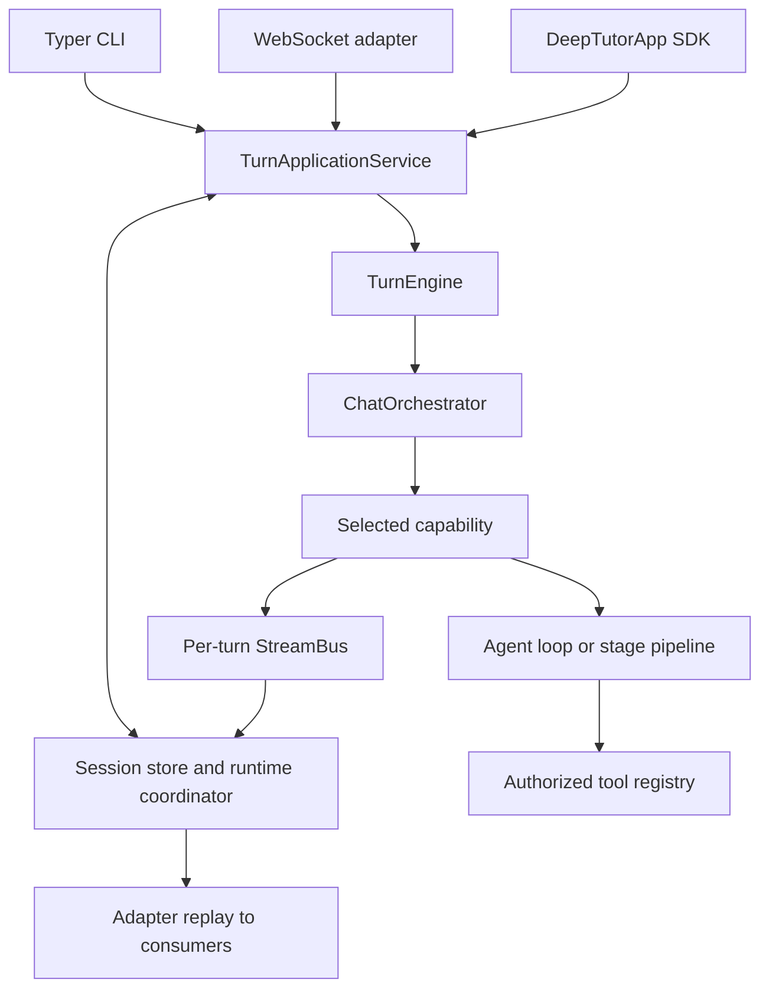

> **中文译本**：本文件由英文原文翻译；命令、路径、配置键、代码块和链接目标保持原样，如译文与实现存在歧义，以英文原文和当前代码为准。

# 架构和源代码所有者

[手册](README.md) · [开发](DEVELOPMENT.md) · [活动](EVENTS_AND_PROGRESS.md)

DeepTutor 1.7.0 是一个带有独立打包的 Python 模块的源存储库。 CLI、WebSocket 和 Python SDK 入口点在执行功能之前汇聚到持久的应用程序服务上。

## 跟踪请求

| 责任 | 源所有者 |
| --- | --- |
| CLI解析和命令 | [`deeptutor_cli/main.py`](../deeptutor_cli/main.py) |
| SDK外观和应用程序请求 | [`deeptutor/app/`](../deeptutor/app/) |
| 持久的准入、执行和重放 | [`app/service.py`](../deeptutor/app/service.py) |
| WebSocket适配 | [`unified_ws.py`](../deeptutor/api/routers/unified_ws.py) |
| 底层执行 | [`runtime/turn_engine.py`](../deeptutor/runtime/turn_engine.py) |
| 上下文到功能路由 | [`runtime/orchestrator.py`](../deeptutor/runtime/orchestrator.py) |
| 能力/工具注册 | [`runtime/registry/`](../deeptutor/runtime/registry/) |
| 模块拥有的贡献 | [`modules/manifests/`](../deeptutor/modules/manifests/) |
| 共享聊天循环 | [`agents/loop/`](../deeptutor/agents/loop/) |
| 持久会话和轮次生命周期 | [`services/session/`](../deeptutor/services/session/) |
| worker租约和通知 | [`runtime/coordination/`](../deeptutor/runtime/coordination/) |

[ `core/context.py` ](../deeptutor/core/context.py) 中的 `UnifiedContext` 是执行上下文。入口点应该使用应用程序服务，而不是实例化编排器来绕过持久状态。持久化、提交身份、重放、取消和恢复属于共享的应用程序/运行时路径。更改流行为之前，请参阅[事件](EVENTS_AND_PROGRESS.md)。

## 工具、功能和模块

工具是一种模型选择的操作。一项功能拥有完整的轮次，并且可以运行共享循环或多级管道。  默认为`chat`；功能激活和上下文决定附加工具的可用性。每个功能都会发出共同的结果范围，包括使用成本。参见[延期合同](TOOLS_AND_CAPABILITIES.md)。

官方 [模块清单](MODULES.md#ownership-and-assembly) 拥有包路径、依赖项、功能、路由器、CLI 组、导航和生命周期回调。已安装、启用和就绪是不同的状态。元数据必须可读，而无需导入不可用的功能包。第三方[插件](PLUGINS.md) 添加自己的审核和生命周期规则；它们与官方模块轮不同。

## 配置和隔离

[ `runtime/home.py` ](../deeptutor/runtime/home.py) 解析运行时主页； [ `services/config/runtime_settings.py` ](../deeptutor/services/config/runtime_settings.py) 拥有设置和支持的进程覆盖。运行时设置位于 `data/user/settings/` 下；  `.env` 不是应用程序配置源。容器启动有自己的 JSON 到环境处理，如 [容器化](CONTAINERIZATION.md#runtime-configuration) 中所述。

帐户授权和工作区选择是单独的检查。路径和服务通过 [ `services/workspace/` ](../deeptutor/services/workspace/) 和 [ `services/path_service.py` ](../deeptutor/services/path_service.py) 解析。选定的工作区数据、帐户凭据和共享资源授予具有不同的生命周期；在接触迁移或缓存之前，请参阅[存储](DATA_STORAGE.md)和[工作空间合约](workspaces.md)。

## 前端边界

[ `web/app/` ](../web/app/) 中的 Next.js App Router 组成页面。域、存储和传输切片位于 [ `web/features/` ](../web/features/) 下。可重用的 UI 和传输原语位于 [ `web/shared/` ](../web/shared/) 下。 [ `web/contracts/` ](../web/contracts/) 保存生成的 API 和合约。

[依赖项规则](../web/.dependency-cruiser.cjs) 禁止循环、路由 `page.tsx` 模块的导入、共享代码的向上依赖项以及从功能域/存储/传输代码的渲染层导入，指定的设置存储异常除外。优先选择现有的传输和存储所有者而不是组件本地 WebSocket、重试或持久性实现。

[ `web/proxy.ts` ](../web/proxy.ts) 将 API/WebSocket 流量转发到后端。浏览器设置和运行时服务器配置是不同的边界；不要将部署地址或机密写入客户端代码中。

## 实验引擎路径

Python 调度程序仍然是默认的。  `DEEPTUTOR_CHAT_ENGINE` 可以选择在 [ `packages/chat-engine/` ](../packages/chat-engine/) 和 [ `runtime/ts_engine/` ](../deeptutor/runtime/ts_engine/) 中实现的实验性 TypeScript 路径。本机路径具有兼容性检查和 Python 集成点。旧的迁移计划并不能证明整个后端已迁移到 TypeScript。这里的更改必须保留应用程序服务、存储和公共事件合约；请参阅[测试](TESTING.md)中的专用引擎作业。