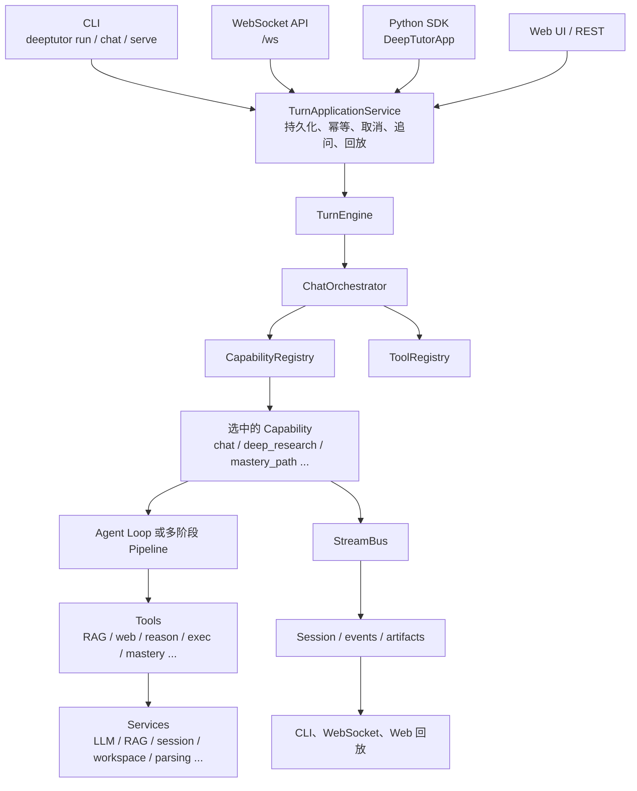

# DeepTutor 项目全景导览（中文）

> 适用版本：DeepTutor 1.7.0 源码树（2026-11-01 核对）。  
> 目标：让新加入的开发者能够从一次用户请求出发，理解 DeepTutor 每个主要目录、运行时概念、能力模块和扩展机制分别负责什么。  
> 如本文与当前代码不一致，以代码和英文开发文档为准。

---

## 1. 一句话理解 DeepTutor

DeepTutor 不是一个简单的 ChatGPT 套壳，也不只是“出题工具”。它更像一个 **Agent-native 的学习运行时与教学能力平台**：

- 对外提供 CLI、WebSocket API、Python SDK、Web UI、IM Partner 等入口；
- 内部以一次 durable turn（可持久化、可回放、可取消的对话轮次）为核心；
- 通过 Tool（单次工具）和 Capability（多阶段教学流程）组织能力；
- 支持 RAG、出题、解题、研究、掌握度、间隔复习、沉浸式阅读、可视化、数学动画、音频微课和视频课；
- 通过模块、插件、Skill、MCP、Partner 等机制扩展。

最核心的判断是：

> **DeepTutor 的主干是一个可持久化、可流式回放、可模块化扩展的 Agent Turn Runtime；教学差异化来自 learning/mastery、RAG、出题解题、研究、阅读、可视化、音视频这些 Capability；CLI、Web、SDK、Partner 都只是这个运行时的不同入口。**

---

## 2. 总体架构



主要层次：

1. **入口层**：CLI、WebSocket、Python SDK、Web/REST、Partner channel。
2. **应用服务层**：`TurnApplicationService`，负责一轮 turn 的持久化、启动、取消、追问、重放。
3. **运行时层**：`TurnEngine`、`ChatOrchestrator`、registry、StreamBus、agent loop。
4. **能力层**：Capability 拥有完整一轮，例如 `deep_research`、`mastery_path`。
5. **工具层**：Tool 是模型按需调用的单次函数。
6. **服务层**：LLM、RAG、session、workspace、parsing、memory、practice 等基础服务。
7. **产品与数据层**：Web、知识库、学习状态、教材、阅读、视频、产物文件。

---

## 3. 一次请求是如何运行的

以“根据这份 PDF 出 5 道题，并判断我哪里薄弱”为例。

### 3.1 入口统一为 TurnRequest

CLI、WebSocket、SDK 最终都会构造一个 `TurnRequest`：

- 核心文件：[`../deeptutor/core/turn_request.py`](../deeptutor/core/turn_request.py)
- 包含内容：
  - 用户输入；
  - `capability`，例如 `deep_question`、`mastery_path`、`deep_research`；
  - 启用的 tools；
  - 知识库列表；
  - 附件；
  - notebook、book、reading 引用；
  - 回答语言；
  - 模型和能力配置；
  - mastery 卡片答案、阅读视口等结构化输入。

`TurnRequest` 是入口协议，真正进入运行时后会转换为 `UnifiedContext`。

### 3.2 TurnApplicationService 接管这一轮

核心文件：[`../deeptutor/app/service.py`](../deeptutor/app/service.py)。

它负责：

- 创建或复用 session；
- 幂等提交；
- 启动 turn；
- 保存用户消息；
- 订阅事件；
- 取消 turn；
- 处理运行中用户补充输入；
- regenerate / retry；
- active turn 恢复；
- 事件持久化和重放。

**不要让入口绕过它直接创建 orchestrator**，否则会绕过持久化、取消和回放机制。

### 3.3 TurnEngine 调用 ChatOrchestrator

- [`../deeptutor/runtime/turn_engine.py`](../deeptutor/runtime/turn_engine.py)：较薄的执行入口。
- [`../deeptutor/runtime/orchestrator.py`](../deeptutor/runtime/orchestrator.py)：真正做能力选择和生命周期管理。

Orchestrator 会：

1. 校验知识库和模块可用性；
2. 根据 `active_capability` 找 Capability；
3. 找不到能力时返回可用能力列表；
4. 创建本轮 `StreamBus`；
5. 调用 `capability.run(context, bus)`；
6. 汇总最终结果、usage 和 cost；
7. 发出 completed/failed 等终态事件。

### 3.4 Capability 接管完整一轮

Capability 是“拥有完整一轮”的教学流程，不只是一个函数。例如：

- `chat`：默认 agentic chat loop；
- `deep_question`：ideation → generation；
- `deep_research`：rephrasing → decomposing → researching → reporting；
- `math_animator`：概念分析 → 分镜 → 生成代码 → 重试 → 渲染；
- `mastery_path`：掌握度门控下的教学循环；
- `video_lesson`：生成 Remotion 代码 → 检查 → 渲染视频。

### 3.5 Agent Loop 调用 Tool

Capability 内部通常运行一个或多个 agent loop。模型根据工具 schema 决定是否调用：

- `rag`
- `web_search`
- `paper_search`
- `reason`
- `exec`
- `ask_user`
- `read_skill`
- mastery、reading、research、solve 等能力自有工具。

工具协议见 [`../deeptutor/core/tool_protocol.py`](../deeptutor/core/tool_protocol.py)。

### 3.6 StreamBus 产出事件

执行过程中通过 `StreamEvent` 持续发事件：

- token 流；
- 工具调用和工具结果；
- 阶段进度；
- 错误；
- 最终结果；
- usage / cost。

WebSocket 可以实时消费，应用服务也可以持久化后回放。

### 3.7 统一结果信封

所有 Capability 最终都应收敛为统一结果，公共逻辑在：

[`../deeptutor/agents/_shared/capability_result.py`](../deeptutor/agents/_shared/capability_result.py)

典型结果包括：

- `response`
- artifacts
- metadata
- `cost_summary` / usage summary

这使 CLI、Web、SDK 和未来 MCP Server 可以用同一种方式读取终端结果。

---

## 4. Tool 与 Capability 的区别

这是理解项目最重要的概念之一。

| 概念 | 粒度 | 所有权 | 例子 |
|---|---|---|---|
| **Tool** | 单次动作 | 被模型或流程调用 | `rag`、`web_search`、`mastery_grade` |
| **Capability** | 完整一轮 | 拥有整个 turn 和阶段流程 | `deep_research`、`mastery_path`、`math_animator` |

可以这样记：

> **Tool 是“一个动作”，Capability 是“一场教学流程”。**

### 4.1 用户可切换的内置工具

权威列表在：

[`../deeptutor/tools/builtin/__init__.py`](../deeptutor/tools/builtin/__init__.py)

| 工具 | 作用 |
|---|---|
| `brainstorm` | 广度发散想法 |
| `web_search` | 网页搜索 |
| `paper_search` | arXiv 论文搜索 |
| `zotero_search` | 搜索 Zotero 文库 |
| `reason` | 专门的深度推理模型调用 |
| `geogebra_analysis` | 数学图片转 GeoGebra 分析 |
| `imagegen` | 生成图片 |
| `videogen` | 生成视频 |

另有大量上下文门控工具：`rag`、memory、notebook、workspace、`read_skill`、MCP/CLI deferred tools、`exec`、`ask_user`、mastery navigation 等。

工具是否挂载，不只由用户开关决定，还受以下因素共同影响：

- 当前 Capability；
- 模块是否安装和启用；
- 知识库、workspace、provider 是否可用；
- Partner 限制；
- 安全策略和工具 mount flags。

---

## 5. 模块系统

DeepTutor 1.7 的模块化信息由 manifest 声明：

[`../deeptutor/modules/manifests/`](../deeptutor/modules/manifests)

每个模块声明：

- Python 包路径；
- 依赖和可选依赖；
- Capability class path；
- Tool class path；
- API router 和 prefix；
- CLI command；
- 导航入口；
- lifecycle callback；
- wheel 分发信息。

常见模块：

| 模块 | 作用 |
|---|---|
| `core` | 默认 chat、ask_questions、基础内置工具 |
| `knowledge` | 知识库和 RAG |
| `questions` | 出题、question bank、practice REST |
| `mastery` | 掌握度路径和学习状态 |
| `reading` | 沉浸式阅读和视频学习材料 |
| `research` | 深度研究和论文工具 |
| `solve` | 分步解题 |
| `visualize` | SVG/Chart.js/Mermaid/HTML 可视化 |
| `renderer-manim` | Manim 数学动画 |
| `video-lesson` | Remotion 视频课 |
| `audio-overview` | KB 双人音频概览 |
| `server` | FastAPI、认证、设置、会话、文件输出等 |
| `web` | Next.js 前端 |
| `partners` | IM 渠道伙伴 |
| `calendar` | cron 与日历任务 |

### 5.1 三种状态

1. **installed**：包是否安装。
2. **enabled**：模块是否启用。
3. **ready**：依赖、二进制、凭证、外部服务是否就绪。

源码 checkout 里能看到目录，不代表 wheel 环境里模块已安装或 ready。

核心代码：

- [`../deeptutor/modules/catalog.py`](../deeptutor/modules/catalog.py)
- [`../deeptutor/modules/lifecycle.py`](../deeptutor/modules/lifecycle.py)

---

## 6. 顶层目录职责

### 6.1 `deeptutor_cli/`：命令行入口

Typer CLI 包。常用命令：

| 命令 | 作用 |
|---|---|
| `deeptutor init` | 初始化运行目录和配置 |
| `deeptutor doctor` | 检查环境、模块、依赖和配置 |
| `deeptutor run <capability> <message>` | 单次运行某个 Capability |
| `deeptutor chat` | 交互式 REPL |
| `deeptutor start` | 启动后端 + 前端 |
| `deeptutor serve` | 只启动 API 服务 |
| `deeptutor kb ...` | 知识库创建、添加、搜索、评估 |
| `deeptutor module ...` | 查看、启用、禁用、安装模块 |
| `deeptutor plugin ...` | 第三方插件管理 |
| `deeptutor skill ...` | Skill 搜索、安装、发布、管理 |
| `deeptutor partner ...` | IM Partner 管理 |
| `deeptutor notebook ...` | 收藏/笔记条目 |
| `deeptutor memory ...` | 记忆查看和清理 |
| `deeptutor session ...` | 会话管理 |
| `deeptutor workspace ...` | Content Workspace |
| `deeptutor config ...` | 配置和 provider |

CLI 也走 `DeepTutorApp` / Turn 服务，不是另一套执行逻辑。

### 6.2 `deeptutor/app/`：应用门面和依赖容器

| 文件 | 作用 |
|---|---|
| `facade.py` | `DeepTutorApp` SDK 门面 |
| `service.py` | `TurnApplicationService`，durable turn 生命周期 |
| `container.py` | 组装 registry、engine、coordinator、store provider |
| `contracts.py` | 应用层契约 |
| `engine.py` | 应用侧执行封装 |

Python 调用 DeepTutor 时优先使用 `DeepTutorApp`。

### 6.3 `deeptutor/core/`：核心协议

| 文件 | 作用 |
|---|---|
| `context.py` | `UnifiedContext`、附件、workspace runtime context |
| `turn_request.py` | 外部入口请求模型 |
| `tool_protocol.py` | Tool 定义、参数、结果 |
| `capability_protocol.py` | Capability 协议和 manifest |
| `stream.py` | StreamEvent 类型 |
| `errors.py` | 核心错误 |
| `identities.py` | Partner 等身份工具 |

该层应保持稳定，不应依赖具体 Web 框架或功能模块。

### 6.4 `deeptutor/runtime/`：运行时编排

| 路径 | 作用 |
|---|---|
| `orchestrator.py` | 选择 Capability、管理 StreamBus、发布终态 |
| `turn_engine.py` | 执行一轮 turn |
| `registry/` | Tool / Capability 注册和延迟加载 |
| `bootstrap/` | 内建 Capability 启动元数据 |
| `agentic/` | 通用 agent loop、tool dispatch、usage、流式工具调用 |
| `stream_bus.py` | 每轮事件总线 |
| `capability_routing.py` | 请求到能力的路由 |
| `request_contracts.py` | 各 Capability 配置模型 |
| `launcher.py` | 后端/前端生命周期和端口发现 |
| `coordination/` | 多进程、后台 leader、租约、恢复、Redis 协调 |
| `background_leader.py` | 后台任务领导权 |
| `isolated_worker.py` / `worker_process.py` | 短命子进程，释放重解析库内存 |
| `ts_engine/` | 实验性 TypeScript chat engine 桥 |
| `providers/` | provider 允许列表、作用域和授权 |

### 6.5 `deeptutor/capabilities/` 与 `deeptutor/agents/`

二者都包含能力实现，但侧重点不同。

#### `capabilities/`

更偏产品能力封装、能力自有工具和适配器，例如：

- `mastery/`
- `reading/`
- `ask_questions/`
- `setup/`
- `handoff/`
- `ima/`
- `marginnote4/`
- `notes/`
- `obsidian/`
- `partner_authoring/`
- `partner_group/`
- `audio_overview/`

#### `agents/`

更偏复杂 Agent / Pipeline：

- `loop/`：共享聊天循环；
- `research/`：深度研究；
- `question/`：出题；
- `visualize/`：可视化生成；
- `math_animator/`：Manim 动画；
- `video_lesson/`：Remotion 视频课；
- `vision_solver/`：视觉解题；
- `notebook/`：笔记相关 agent；
- `chat/`：默认聊天能力；
- `_shared/`：共享结果、工具和流程代码。

运行时最终只认 manifest 中的 class path 和 `TurnCapability` 协议，不依赖目录命名。

### 6.6 `deeptutor/tools/`：工具实现

包含：

- builtin tools；
- RAG tool；
- web/paper/Zotero 搜索；
- workspace 工具；
- question bank；
- mastery navigation；
- read skill；
- media generation；
- 各能力自有工具。

### 6.7 `deeptutor/services/`：基础设施服务

可以按功能分组理解。

#### 模型和 AI 服务

- `llm/`：模型发现、OpenAI-compatible 调用、缓存、usage、provider；
- `model_selection/`：任务默认模型选择；
- `prompt/`：prompt pack；
- `embedding/`：embedding 配置；
- `imagegen/`、`videogen/`：图片/视频生成；
- `voice/`：语音参数和 TTS；
- `subagent/`：本地/远程子智能体连接；
- `codex_auth/`：Codex OAuth 模型目录。

#### 知识、文档和搜索

- `parsing/`：文档解析服务；
- `rag/`：RAG pipeline；
- `search/`：网页搜索安全过滤；
- `web_source/`：抓取网页到知识库；
- `github_source/`：从 GitHub 仓库同步 Markdown；
- `storage/`：File Library。

#### 会话、配置和工作区

- `session/`：会话、turn、模型私有历史、SQLite/PocketBase store；
- `workspace/`：Content Workspace、路径作用域、资源、迁移；
- `config/`：runtime settings；
- `settings/`：设置编辑器和模型目录应用；
- `path_service.py`：运行目录和文件路径解析。

#### 学习相关

- `practice/`：练习题导入、CSV/XLSX/JSON 解析、复习分析；
- `learning_journal/`：学习日志；
- `notebook/`：收藏/笔记本；
- `memory/`：三层记忆系统。

#### 协作和扩展

- `partners/`、`partner_groups/`：IM Partner；
- `calendar/`、`cron/`：日历和定时任务；
- `mcp/`：**DeepTutor 作为 MCP 客户端连接外部 MCP Server**；
- `skill/`：Skill 读取、安装和管理；
- `cli_apps/`：CLI App 目录；
- `sandbox/`：执行沙箱相关能力。

> 注意：当前没有对外 MCP Server，也没有 `deeptutor mcp serve`。`services/mcp/` 是客户端管理器。

### 6.8 `deeptutor/learning/`：掌握度教学内核

这是 DeepTutor 与普通 RAG 聊天机器人差异最大的部分之一。

负责：

- 知识点；
- 学习模块；
- 学习阶段状态机；
- 诊断；
- 题目和答题；
- 错题；
- 证据；
- 掌握度；
- 间隔复习；
- 语义评估；
- 教学策略；
- 路径生成和修订；
- 学习者画像。

关键文件：

| 文件 | 作用 |
|---|---|
| `models.py` | KnowledgePoint、LearningModule、QuizAttempt、ReviewTask、LearningProgress 等 |
| `service.py` | LearningService，掌握度路径核心服务 |
| `storage.py` | mastery SQLite 持久化 |
| `grading.py` | 客观题判分 |
| `semantic_assessment.py` | LLM 语义判分 |
| `scheduler.py` | 间隔重复调度 |
| `policy.py` | 教学策略 |
| `navigation.py` | 下一步导航 |
| `question_card.py` | 题卡构造 |
| `event_hub.py` | 掌握度事件 |
| `topic_generation.py` | 主题/路径生成 |
| `topic_materials.py` | 主题材料绑定 |

当前掌握度数据默认写入 workspace 下的 `learning/mastery.sqlite3`，适合本地/单节点，不等同跨主机 SaaS 多副本存储。

### 6.9 `deeptutor/knowledge/`：知识库管理

负责 KB 元数据、索引管线、文件、RAG provider 配置等。

实际检索 pipeline 多位于 `services/rag/`，HTTP API 位于 `api/routers/knowledge.py`。

支持形态包括：pageindex、LlamaIndex、GraphRAG、LightRAG、LightRAG server、ima、Kiwix、Obsidian、MarginNote 等。

### 6.10 `deeptutor/reading/` 与 `deeptutor/video_learning/`

- `reading/`：文档/PDF/教材式材料、tab、页码、章节引用、图片、标注、阅读会话。
- `video_learning/`：外部视频、字幕、时间戳、视频笔记、Invidious 授权。

### 6.11 `deeptutor/api/`：FastAPI 后端

- 入口：[`../deeptutor/api/main.py`](../deeptutor/api/main.py)
- Router：[`../deeptutor/api/routers/`](../deeptutor/api/routers)

典型 router：

| Router | 作用 |
|---|---|
| `unified_ws.py` | 统一 WebSocket turn 协议 |
| `sessions.py` | 会话和 turn REST 辅助 |
| `auth.py` | 注册、登录、JWT、device login、session handoff |
| `multi_user.py` | 多用户、guardian、权限、学习者材料 |
| `knowledge.py` | 知识库、RAG provider、文件和配置 |
| `practice.py` | 练习队列、判分、间隔复习 |
| `mastery_path.py` | 掌握度路径、知识点、进度、事件、会话 |
| `question.py` | 出题 WebSocket |
| `quiz_judge.py` | 主观题/图片题判分 |
| `reading.py` / `video_learning.py` | 文档和视频学习 |
| `outputs.py` | 产物文件 |
| `plugins.py` / `skills.py` / `mcp_settings.py` | 插件、Skill、MCP 配置 |
| `partners.py` / `partner_groups.py` | IM Partner |
| `dashboard.py` | 首页/仪表盘聚合 |
| `visualizers.py` | 可视化器管理 |

资源管理更适合 REST；真正的流式 turn 主要走 WebSocket。

### 6.12 `web/`：Next.js 前端

| 路径 | 作用 |
|---|---|
| `web/app/` | App Router 页面 |
| `web/features/chat/` | 聊天 UI、消息、controller、transport、trace |
| `web/features/knowledge/` | 知识库 UI 和 API |
| `web/features/settings/` | 设置页 |
| `web/features/calendar/` | 日历 |
| `web/features/co-writer/` | 文档/笔记协作写作 |
| `web/features/multi-user/` | 登录和多用户 UI |
| `web/shared/` | 可复用 UI 和 transport primitive |
| `web/contracts/` | 生成的 API / turn 协议 |
| `web/lib/` | 前端基础库 |
| `web/i18n/`、`web/locales/` | 国际化 |
| `web/proxy.ts` | 开发代理 |

[`../deeptutor_web/`](../deeptutor_web) 是 wheel 打包时承载 Next.js standalone 产物的包；源码开发时主要使用 `web/`。

### 6.13 其他领域包

| 包 | 作用 |
|---|---|
| `book/` | 教材/书籍式内容生成、编译、页面和 quiz block |
| `textbook_struct/` | 教材结构化字段和特征列 |
| `notes/` | 学习笔记/块文档 |
| `co_writer/` | 协作写作能力 |
| `visualizers/` | 可视化器安装、启用、资产和声明式导入 |
| `partners/` | QQ、飞书、微信、Matrix、MS Teams 等 IM 通道 |
| `multi_user/` | 本地多用户、账号、授权、guardian/learner |
| `plugins/` | 第三方插件生命周期、审核、分发、目录 |
| `i18n/` | 状态和元数据国际化 |
| `logging/` | 日志体系 |
| `events/` | 内部事件抽象 |
| `utils/` | 通用工具 |

---

## 7. Capability 全景

| Capability | 阶段/形态 | 用途 |
|---|---|---|
| `chat` | exploring → responding | 默认 Agentic 聊天 |
| `ask_questions` | responding | 强制通过 `ask_user` 澄清问题 |
| `deep_solve` | responding + solve tools | 多步解题、规划、重规划 |
| `deep_question` | ideation → generation | 根据材料/知识点出题 |
| `deep_research` | rephrasing → decomposing → researching → reporting | 深度研究和证据报告 |
| `visualize` | analyzing → generating → reviewing | SVG、Chart.js、Mermaid、HTML，也可路由 Manim |
| `math_animator` | concept analysis → design → code → retry → render | Manim 数学动画 |
| `mastery_path` | 掌握度门控教学循环 | 自适应学习路径 |
| `immersive_reading` | 文档/时间戳 grounded 多轮阅读 | 精读材料/视频 |
| `audio_overview` | retrieval → script → voice → publish | KB 双人音频概览和逐字稿 |
| `video_lesson` | code generation → check → render | Remotion 视频课 |
| `handoff` | 特殊路由 | Partner 或其他代理代答 |

重依赖：

- `video_lesson`：Node.js、npm、Remotion、TTS；
- `math_animator`：Manim、LaTeX、ffmpeg；
- `audio_overview`：知识库和 TTS；
- `deep_research`：网络/论文搜索，可选 KB；
- `immersive_reading`：reading 模块和材料。

---

## 8. 配置、数据和运行目录

### 8.1 Runtime Home

运行目录由 `runtime/home.py` 和 `PathService` 决定，可通过以下方式指定：

- `DEEPTUTOR_HOME`
- `deeptutor start --home`
- `deeptutor init --home`

常见本地布局：

| 路径 | 内容 |
|---|---|
| `data/user/settings/` | JSON/YAML 设置、模型配置、凭证引用 |
| `data/user/chat_history.db` | 会话、消息、turn、题库/练习等 |
| `data/user/.runtime/` | workspace registry 等运行时 SQLite |
| `data/user/workspace/` | 默认 Content Workspace 和产物 |
| `data/knowledge_bases/` | 知识库源文件、索引和缓存 |
| `data/parse_cache/` | 文档解析缓存 |
| `data/users/<uid>/` | 本地多用户模式下每用户 workspace |
| `data/partners/<id>/` | Partner 合成工作区 |
| `data/system/` | 本地账号、授权、审计等 |

项目根目录 `.env` 不是当前架构推荐的主配置来源；运行时设置主要位于 `data/user/settings/*.json/yaml`。

### 8.2 当前存储现状与 SaaS 目标

当前代码默认是：

- SQLite；
- 普通文件；
- workspace 目录；
- 可选 PocketBase。

目前没有受支持的 Postgres/MySQL 存储切换。`DATABASE_URL` 不会自动把所有 DeepTutor 状态迁到外部数据库。

已有的是**可选本地多用户**：

- JWT、角色、账号、grants；
- 默认 `AUTH_ENABLED=false`；
- 数据主要按 `data/users/<uid>/` 隔离。

尚未有的是商业 SaaS 能力：

- 组织/租户模型；
- Postgres 行级隔离；
- 订阅、支付、席位、计量；
- 完整多副本云存储。

WorkBuddy 方案中设计的 Postgres-only 多账户架构是目标方案，不是当前代码事实。

---

## 9. Skill、Plugin、MCP、Partner 的区别

### 9.1 Skill

Skill 主要是 Markdown 指令包，告诉模型：

- 什么时候触发；
- 怎么工作；
- 可引用哪些参考资料；
- 可选带脚本/模板。

内置 Skill 位于：

[`../deeptutor/skills/builtin/`](../deeptutor/skills/builtin)

Skill 本身不是强类型工具，也不天然提供持久化能力。

### 9.2 Plugin

Plugin 是第三方 Python 扩展，可声明：

- Tool；
- Capability；
- HTTP router；
- 静态页面；
- worker；
- 权限。

插件有安装、批准、启用、禁用、回滚等生命周期。

参考：

- [`../deeptutor/plugins/`](../deeptutor/plugins)
- [`PLUGINS.md`](PLUGINS.md)
- [`examples/learning_echo/`](examples/learning_echo)

### 9.3 MCP

当前 DeepTutor 是 MCP **客户端**：

- 可连接外部 MCP Server；
- 外部 tools 可进入 DeepTutor 工具体系。

代码位于：

[`../deeptutor/services/mcp/`](../deeptutor/services/mcp)

当前没有：

- `deeptutor/mcp_server/`
- `deeptutor mcp serve`

因此“DeepTutor 对外提供 MCP Server”是规划，不是现状。

### 9.4 Partner

Partner 是 IM/聊天渠道中的学习伙伴，例如飞书、微信、Matrix、Teams、QQ 等。

它负责：

- 渠道连接；
- 消息收发；
- 群聊/单聊；
- Partner 独立记忆；
- 渠道文件和语音；
- 后台运行。

Partner 与 Skill/MCP 是不同扩展维度。

---

## 10. TypeScript Chat Engine

[`../packages/chat-engine/`](../packages/chat-engine) 是实验性 TypeScript 聊天引擎。

它可以在私有 Node 子进程里承担：

- Chat Completions 模型调用；
- SSE 解码；
- 历史预算；
- rolling summary；
- 工具批处理；
- 原生 workspace、memory、reason、brainstorm 等部分工具。

Python 仍然拥有：

- 鉴权；
- durable turns；
- session storage；
- Capability admission；
- Partner channel；
- 大部分复杂工具和教学能力。

默认仍是 Python engine。TS engine 通过：

```bash
DEEPTUTOR_CHAT_ENGINE=typescript-native deeptutor start
```

启用。它是实验 profile，不是 Python 后端的完整替代。

---

## 11. 常见问题排查地图

| 现象 | 优先查看 |
|---|---|
| CLI 命令参数不对 | `deeptutor_cli/main.py` 和对应命令文件 |
| WebSocket 收不到事件 | `api/routers/unified_ws.py`、`app/service.py` |
| Turn 没有持久化/不能取消/不能回放 | `app/service.py`、`services/session/` |
| 选错 Capability | `runtime/orchestrator.py`、`runtime/capability_routing.py`、`TurnRequest.capability` |
| 工具没出现在模型请求里 | manifest、`runtime/registry/`、tool mount flags、用户工具开关、Capability 工具列表 |
| RAG 没检索 | `knowledge/`、`services/rag/`、parsing、KB 设置 |
| 出题不对 | `agents/question/`、`api/routers/question.py`、`services/practice/` |
| 掌握度不对 | `learning/service.py`、`storage.py`、`scheduler.py`、`grading.py` |
| 阅读引用不对 | `reading/`、`capabilities/reading/` |
| 视频/动画渲染失败 | Node/npm、`agents/video_lesson/`、`agents/math_animator/`、Manim/ffmpeg/LaTeX |
| 产物找不到 | workspace/output、`api/routers/outputs.py` |
| 模型或 provider 问题 | `services/llm/`、`services/model_selection/`、`data/user/settings/model_catalog.json` |
| 多用户数据串了 | `multi_user/`、`services/workspace/context.py`、auth 依赖 |
| 插件不生效 | `plugins/`、`api/routers/plugins.py`、插件 manifest 和审批状态 |
| 前端状态问题 | `web/features/chat/`、transport、selectors、`web/contracts/` |

---

## 12. 最重要的注意事项

1. DeepTutor 不是单一聊天机器人，核心是 Capability + Tool 的 Agent Turn Runtime。
2. Capability 不是 Tool：Capability 拥有完整一轮，Tool 是单次动作。
3. CLI/Web/SDK 不应绕过 `TurnApplicationService`。
4. 源码目录有代码不等于 wheel 环境中已 installed/enabled/ready。
5. 当前 `services/mcp/` 是 MCP 客户端，不是 MCP 服务端。
6. 当前默认数据后端是 SQLite/文件，不是 Postgres SaaS。
7. 多用户不等于多租户；现有本地多用户主要是账号 + workspace 隔离。
8. Skill 主要是提示词/流程说明，不是能力实现本身。
9. Workspace 物理路径不能暴露给模型或前端公开 URL。
10. 视频/数学动画是重能力，依赖 Node、Remotion、Manim、LaTeX、ffmpeg、TTS，不应伪装成同步短工具。

---

## 13. 推荐源码阅读顺序

1. [`../AGENTS.md`](../AGENTS.md)：建立整体架构。
2. [`../deeptutor/core/turn_request.py`](../deeptutor/core/turn_request.py)：看入口输入。
3. [`../deeptutor/core/context.py`](../deeptutor/core/context.py)：看运行时统一上下文。
4. [`../deeptutor/app/service.py`](../deeptutor/app/service.py)：看 durable turn。
5. [`../deeptutor/runtime/orchestrator.py`](../deeptutor/runtime/orchestrator.py)：看 Capability 执行。
6. [`../deeptutor/core/tool_protocol.py`](../deeptutor/core/tool_protocol.py) 和 [`../deeptutor/tools/builtin/__init__.py`](../deeptutor/tools/builtin/__init__.py)：看工具协议和内置工具。
7. 先看简单 Capability：`chat` / `ask_questions`；再看复杂 Capability：`deep_research` / `mastery_path` / `math_animator`。
8. [`../deeptutor/modules/manifests/`](../deeptutor/modules/manifests)：看功能如何组装进运行时。
9. [`../deeptutor/learning/`](../deeptutor/learning)：理解掌握度、证据、复习和学习路径。
10. 最后看前后端连接：[`web/features/chat/`](../web/features/chat) 和 [`../deeptutor/api/routers/unified_ws.py`](../deeptutor/api/routers/unified_ws.py)。
