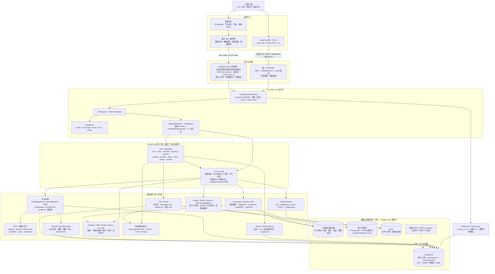
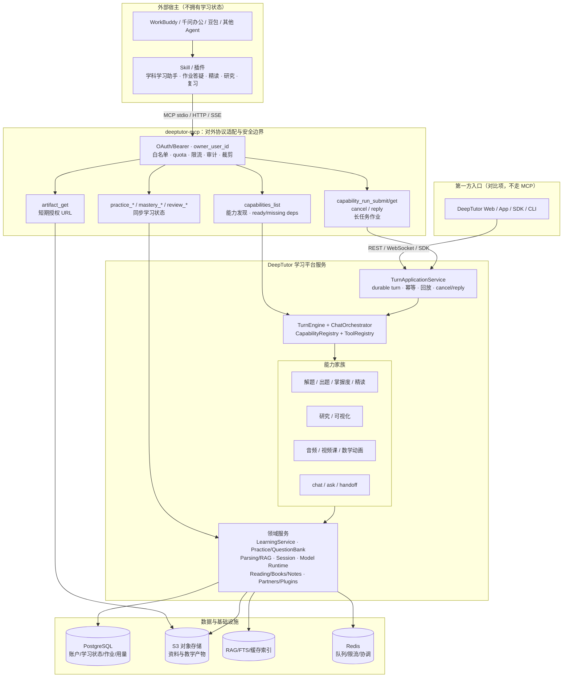
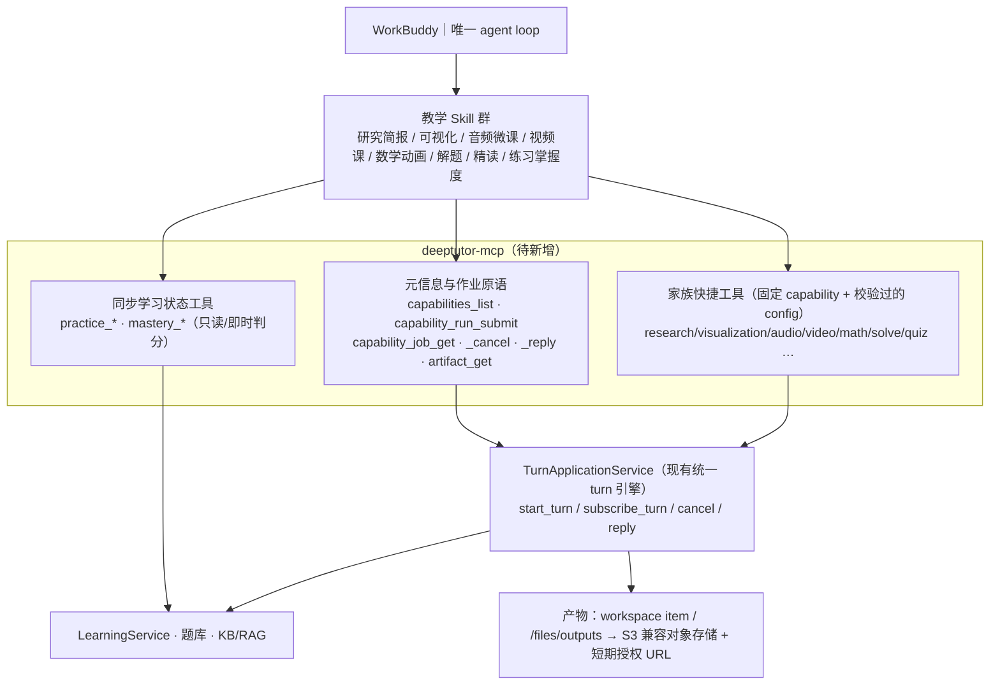
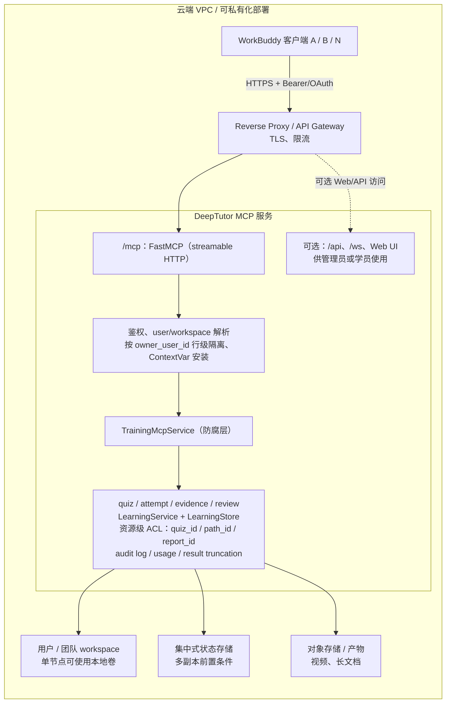
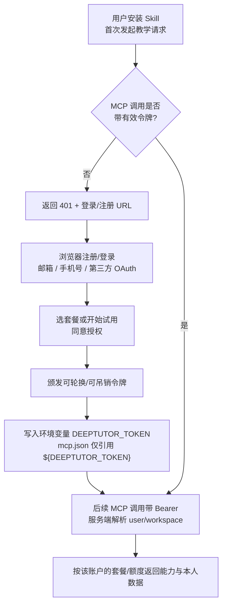
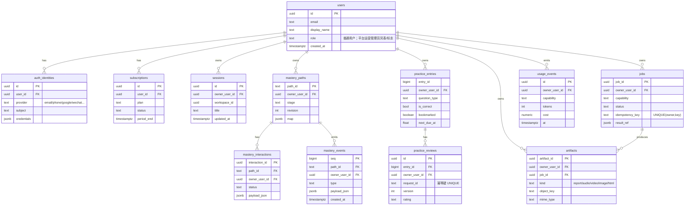

# DeepTutor C 端全学段 AI 学习平台 × 腾讯 WorkBuddy 集成方案

> 目标：在“DeepTutor 是 C 端全学段 AI 学习平台”的主定位下，判断它与腾讯 WorkBuddy（<https://www.workbuddy.cn/>）如何集成、哪些能力值得接入。
> 本文结构：WorkBuddy 事实调研 → DeepTutor 资产覆盖度盘点 → 价值判断 → 可执行方案。
> 姊妹文档：面向 DeepSeek Harness 的同题方案见 [DSH_INTEGRATION.md](./DSH_INTEGRATION.md)。**两者的结论相反**，原因见 §3。

---

## 0. 结论（TL;DR）

**定位修正（2026-11-01）：DeepTutor 的主定位不是“企业培训练习与掌握度服务”，而是面向 C 端全学段学习者的 AI 学习平台。** B 端培训只是未来可复用同一学习内核切入的 B 端垂直场景，不应反过来限制产品能力和品牌叙事。

### 0.1 主定位：从 K12 到大学、研究生的个人 AI 学习平台

DeepTutor 现有能力天然覆盖完整学习链路，而不只是企业员工培训：

| 学段 / 人群 | 典型需求 | DeepTutor 对应能力 |
| ---- | ---- | ---- |
| K12 | 作业辅导、错题本、知识点诊断、分层练习、数学概念动画、家长/老师辅助 | `deep_solve`、`deep_question`、`mastery_path`、practice/question bank、`math_animator`、`visualize` |
| 大学本科 | 课程自学、教材精读、题库练习、实验/图表、论文前的资料理解 | `immersive_reading`、`mastery_path`、`visualize`、RAG/KB、`deep_research` |
| 研究生 / 科研入门 | 文献调研、论文检索、研究报告、学术写作前的证据整理、音频复习 | `deep_research`、`paper_search`、`audio_overview`、KB/RAG、co-writer/notes |
| 终身学习者 | 书籍/文档精读、视频学习、可视化讲解、个性化复习 | reading/video learning、`visualize`、间隔复习、掌握度路径 |
| B 端培训（后续 B 端垂直包） | 员工入职、产品知识、合规学习、团队报表 | 同一学习内核 + 组织/席位/机构/团队报表扩展 |

因此产品叙事应从“给企业 HR/培训部门做练习系统”改为：

> **一个陪个人学习者从理解、解题、练习、错题、掌握度追踪，到研究、精读和音视频复习的 AI 学习平台。**

WorkBuddy 集成仍有价值，但它在战略上只是**渠道与宿主之一**：可用于触达教师、家长、大学生办公学习场景和知识工作者；不能把 DeepTutor 的全部能力压缩成 WorkBuddy 里的“培训 Skill”。

### 0.2 WorkBuddy 这一宿主的机会与边界

WorkBuddy 是办公向 AI 工作台，已经具备通用 RAG、文档、PPT、深度研究和文件处理能力。若只把 DeepTutor 包装成泛办公助手，会与宿主重复；但它仍然缺少面向个人学习者的**长期学习状态与教学闭环**：

- 跨会话的知识点、错题、掌握度和间隔复习；
- 从诊断 → 讲解 → 练习 → 判分 → 复习的连续路径；
- 数学动画、可讲解视频、音频微课、逐段精读等教学媒体；
- 面向 K12/大学/研究生的学科化学习体验。

> WorkBuddy 教育版已有 K12 教师向单点 Skill（出题/组卷/错题/学情），这说明教育需求成立；但这些多是一次性工具，缺 DeepTutor 的持久学习状态、证据链、自适应路径和多媒体教学能力。

**接入形态**：DeepTutor 自有 App/Web/SDK 直接走内部 API；WorkBuddy、千问办公、豆包等外部宿主则通过“个人 AI 学习助手 / 学科学习伙伴”等 Skill/插件门面调用 DeepTutor MCP。外部宿主保持自己的唯一 agent loop，DeepTutor 只提供学习领域能力、学习状态和教学产物；B 端培训仅作为未来可选 Skill 包，不进入主定位。



**DeepTutor 全能力矩阵**

| 层 | 模块/能力 | 覆盖内容 |
| --- | --- | --- |
| 入口能力 | `chat`、`ask_questions`、`handoff` | 基础问答、澄清追问、伙伴/外部智能体代答 |
| 解题 | `deep_solve`、`reason`、`geogebra_analysis` | STEM 分步解题、规划/重规划、数学图片/GeoGebra 分析 |
| 研究 | `deep_research`、`web_search/web_fetch`、`paper_search/preprint`、`research_audit/research_lit`、`zotero_search` | 问题拆解、网页/论文检索、证据审查、研究报告、文献管理 |
| 出题测评 | `deep_question`、question bank、`quiz_judge`、practice REST | 出题/组卷、诊断题、客观/主观判分、错题、复习评分 |
| 掌握度 | `mastery_path`、`LearningService`、mastery tools | 知识点、学习阶段、证据、掌握度门控、自适应路径、学习者画像 |
| 间隔复习 | `scheduler`、ReviewTask、practice queue | 到期复习、错题回顾、间隔重复、幂等 review |
| 精读与视频学习 | `immersive_reading`、reading tools、video learning | PDF/教材/网页/视频逐段读、页码/章节/时间戳引用、标注、字幕 |
| 可视化 | `visualize`、`submit_visualization`、visualizers | SVG、Chart.js、Mermaid、HTML，可扩展渲染器 |
| 音频 | `audio_overview`、TTS | 资料检索、讲稿、双人音频概览、逐字稿 |
| 视频/动画 | `video_lesson`、`math_animator` | Remotion 视频课、Manim 数学动画、LaTeX/ffmpeg 渲染 |
| 知识与 RAG | knowledge、parsing、RAG pipelines、KB tools、Obsidian/MarginNote/ima/Kiwix | 文档解析、切片索引、企业/个人资料库、外部知识库连接器 |
| 内容生产 | books、textbook struct、notes、co-writer | 教材编译、quiz block、块笔记、协作写作 |
| 工作区与文件 | workspace tools、attachments、file library、outputs | 逻辑工作区、文件读写/展示/导出、产物 URL、附件解析 |
| 记忆与个性化 | memory、persona、learning journal、learner profile | 长期记忆、偏好、角色、学习日志、画像 |
| 扩展生态 | plugins、skills、MCP clients、subagents、partners、calendar/cron | 第三方插件、Skill、外部 MCP 工具、子智能体、IM 伙伴、定时任务 |
| 平台能力 | auth/multi-user、module lifecycle、usage、observability、i18n | 注册登录、模块就绪、用量成本、日志追踪、中英文状态 |


> **能力怎么给到 WorkBuddy（进程模型 / 传输 / 鉴权 / 部署）见 §5。**
>
> **通道边界**：DeepTutor 自有 App/Web/SDK 是第一方入口，应直接调用内部应用 API、`TurnApplicationService`、REST 或 WebSocket，**不需要、也不应该绕一圈走 MCP**。`deeptutor-mcp` 是给 WorkBuddy、千问办公、豆包等**外部宿主**准备的协议适配与安全边界：宿主内的 Skill/插件通过 MCP 调用 DeepTutor 能力。两条入口最终复用同一个学习内核与账户数据，但鉴权、工具裁剪、产物授权和审计在 MCP 层额外收口。

> **全能力覆盖**：上图中的 Capability 层来自现有模块 manifest——`chat/ask_questions`（core）、`deep_solve`（solve）、`deep_research`（research）、`deep_question`（questions）、`mastery_path`（mastery）、`immersive_reading`（reading）、`visualize`（visualize）、`audio_overview`（audio-overview）、`video_lesson`（video-lesson）、`math_animator`（renderer-manim）和 `handoff`；Tool 层覆盖检索研究、RAG/材料、工作区、学习动作、受控执行、媒体生成、Skill/MCP/Partner 等扩展。

> **代码状态（2026-10-31 核对）**：仓库当前只有 DeepTutor 作为 **MCP 客户端**的 `deeptutor/services/mcp/`；对外的 `deeptutor/mcp_server/` 与 `deeptutor mcp serve` 尚不存在。[DSH_INTEGRATION.md §5.0](./DSH_INTEGRATION.md) 的 10 条约束仍然适用，但 §8.3 是**待实现骨架**，不是可直接复用的现成模块。

---

## 1. 调研：腾讯 WorkBuddy 是什么

### 1.1 定位与产品矩阵

WorkBuddy 是腾讯出品的**全场景 AI 办公工作台**（桌面端）。核心主张是"区别于仅提供建议的传统 AI 对话"：一句话下达任务 → 自主拆解规划 → 操作本地文件与外部系统 → **交付可验收的产物**（文档、数据分析、PPT/报告、深度研究、邮件/周报、批量文件处理）。

它属于 **WorkBuddy Enterprise** 这个总品牌，与另外两款产品并列：

| 产品                         | 定位                           | 关键点                                                                                                            |
| ---------------------------- | ------------------------------ | ----------------------------------------------------------------------------------------------------------------- |
| **CodeBuddy**                | AI 原生全流程编程工具          | IDE / 插件 / CLI 三形态；内置 Figma 转代码；集成 Supabase、CloudBase；可部署 CloudStudio、EdgeOne Pages           |
| **WorkBuddy**                | 全场景职场 AI 智能体桌面工作台 | 本文的宿主；5 类插件；资料库（ima / 腾讯文档 / 乐享）；连接器；专家                                               |
| **WorkBuddy Managed Agents** | 云端托管的智能体运行服务       | **底层基于 WorkBuddy Harness 内核**；内置编排 + 独立沙箱；统一身份、全链路 Trace、效果评测、秒级 COW Fork、预热池 |

### 1.2 插件体系（五类）

官方插件页给出的类型划分：

| 类型      | 说明                                    |
| --------- | --------------------------------------- |
| **Skill** | 技能插件，为 WorkBuddy 添加特定领域能力 |
| **MCP**   | 连接外部服务和数据源                    |
| **Hook**  | 在特定时机自动执行操作                  |
| **Agent** | 智能体插件，提供专门的任务处理能力      |
| **Rule**  | 规则插件，定义 WorkBuddy 的行为规范     |

支持内置插件列表与**第三方插件市场**（输入市场地址后浏览安装）。

### 1.3 MCP：配置方式与能力边界

WorkBuddy 把 MCP 配置**集成进界面**（侧边栏「插件 → MCP 服务器 → 配置 MCP」），无需手改文件。底层仍是标准 `mcpServers` JSON：

| 级别       | 配置文件路径                     | 适用场景               |
| ---------- | -------------------------------- | ---------------------- |
| **用户级** | `~/.workbuddy/mcp.json`          | 配置一次，所有项目复用 |
| **项目级** | `<项目目录>/.workbuddy/mcp.json` | 仅当前项目生效         |

官方支持 **`STDIO` / `SSE` / `HTTP` 三种传输**，`type` 字段可省略并按字段推断（有 `command` → stdio，有 `url` → http）。下面给出 stdio 与 http 两个示例（`sse` 结构同 `http`，属过渡兼容；选型见 §5.2）：

> 下面是**目标配置**；对应的 `deeptutor mcp serve` 入口属于待实现项，当前仓库还不能直接运行。

```json
{
  "mcpServers": {
    "deeptutor": {
      "type": "stdio",
      "command": "/abs/path/to/.venv/bin/python",
      "args": ["-m", "deeptutor_cli.main", "mcp", "serve", "--transport", "stdio"],
      "env": { "DEEPTUTOR_HOME": "/abs/path/to/DeepTutor" }
    }
  }
}
```

```json
{
  "mcpServers": {
    "deeptutor": {
      "type": "http",
      "url": "https://deeptutor.internal/mcp",
      "headers": { "Authorization": "Bearer ${DEEPTUTOR_TOKEN}" }
    }
  }
}
```

**能力边界**：本方案 MVP 只暴露 MCP **tools**，首发不依赖 Resources / Prompts。这样可以同时兼容 WorkBuddy 办公端的"外部工具/数据源"用法和 CodeBuddy CLI 的通用 MCP 能力；后者文档中虽包含 Resources / Prompts / 斜杠命令等能力，但不作为 WorkBuddy CN 首发依赖。WorkBuddy 侧还提供[腾讯云 MCP 市场](https://cloud.tencent.com/developer/mcp)作为分发入口。三种传输的**进程模型、鉴权与部署**见 §5。

### 1.4 Skill：结构与上架规范

WorkBuddy 的 Skill 是**纯声明式文件**（无需写 TS/JS 插件代码），开放平台上架的结构为：

```
{skill-name}/
├── SKILL.md          # ★ 必须：YAML frontmatter + Markdown 正文
├── references/       # 可选：被 SKILL.md 以 @references/xxx.md 引用的补充知识
├── scripts/          # 可选：AI 通过 Bash 工具执行的脚本（.py / .js / .sh）
└── templates/        # 可选：可复用的模板脚本或配置
```

`SKILL.md` 的 frontmatter 字段（**必填项比通用 SKILL.md 规范多**）：

| 字段              | 必填 | 说明                       |
| ----------------- | ---- | -------------------------- |
| `name`            | 是   | 技能标识                   |
| `display_name`    | 是   | 市场上展示的中文名         |
| `display_name_en` | 是   | 市场上展示的英文名         |
| `description`     | 是   | 写清用途和触发词           |
| `description_zh`  | 是   | 技能详情页的中文简介       |
| `description_en`  | 是   | 技能详情页的英文简介       |
| `version`         | 是   | 版本号                     |
| `author`          | 是   | 合作方名称                 |
| `allowed-tools`   | 否   | 工具白名单（逗号分隔）     |
| `examples_zh/en`  | 否   | 详情页「试试这样用」的示例 |

> ⚠️ **这是 DeepTutor 现有 `SKILL.md` 无法直接上架的原因**：它只有 `name` + `description`，上架市场还需补 `display_name(_en)` / `description_zh/_en` / `version` / `author` 五项。这是**零代码但必须做的元数据补齐**。

`scripts/` 目录是**被低估的接入点**：它允许直接放 Python 脚本，由 WorkBuddy 通过 Bash 工具执行。这意味着可以**不写 MCP 桥**，直接在技能里调 `deeptutor run ...`。

### 1.5 资料库 / 连接器 / 专家

- **资料库（知识底座）**：腾讯文档、**ima 知识库**、乐享知识库。其中 ima 是**基于 RAG 的知识库**，支持把 `.pdf/.docx/.xlsx/.pptx/.txt/.md` 建立索引；资料库支持**语义搜索**与关键词搜索，可「添加到任务」，产物可「存回」知识库。
- **连接器**：技术形态为 **MCP + CLI** 或 **Skill + CLI**；内置 QQ 邮箱、腾讯文档、腾讯乐享、腾讯会议、TAPD、腾讯网盘；**自定义连接器 = 安装自定义 MCP 服务**。
- **专家（Expert Center）**：通过对话式引导创建"专家"，配置提示词与能力组合。
- **计费口径**：连接器自身的读写**不消耗积分**；WorkBuddy 对**外部数据**做理解、汇总时**消耗积分**。

### 1.6 发布与合规（WorkBuddy 独有约束）

Skill 上架前会经过**安全扫描**，检查项包括：

- 硬编码密钥或 API Key
- 会导致用户数据外泄的指令
- 在技能范围外修改系统的命令
- 已废弃或不安全的 API 调用

未通过扫描的技能**无法发布**。

### 1.7 已有生态：学习类 Skill 盘点（2026-10 复查）

这一节回答一个关键问题：**WorkBuddy 上是否已经有"学习工具"了？** 答案是**有，但形态不同**。

#### （1）已成体系的「12 款教师 Skill」

2026-09 起在教师社群流传的一套工作流 Skill，按教学环节划分：

| 环节       | Skill                                                                                                                                    |
| ---------- | ---------------------------------------------------------------------------------------------------------------------------------------- |
| 备课       | `lesson-pack`、`office-kejian`、`k12-lesson-design`、`yueureka-lab-edu`                                                                  |
| **出卷**   | `exam-generator`（按年级 / 教材版本 / 学科 / 知识点出卷，选择/填空/判断/阅读/计算/作文全覆盖）、`tizhuang-question-bank`、`chuti-zujuan` |
| **错题集** | `cuoti-fast`、`xueqing-analysis`、`class-analysis` 系列                                                                                  |
| 地基       | `find-skills`（技能检索）、`skill-creator`（技能自造）                                                                                   |

#### （2）厂商级产品：【教师备课与班主任工作台】Skill

**泰安深度网络科技**专为 **WorkBuddy 教育版**打造，2026-10-29 上线，共 12 项功能。其中与本方案重叠度最高的：

| 功能           | 说明                                                                                      |
| -------------- | ----------------------------------------------------------------------------------------- |
| **单元组卷**   | "先确认后生成"：先出**双向细目表**供教师审核，再产出学生卷 / 答案卷，带**分值守恒硬校验** |
| **错题变式**   | 粘贴错题 → 自动知识点归类 → 生成变式题（明确"杜绝同质化伪变式"）                          |
| **分层作业**   | A 基础 / B 提升 / C 挑战 + 完整参考答案与评分标准                                         |
| **试卷讲评**   | 结合班级得分率，生成讲评教案与补偿练习                                                    |
| **学情分析**   | 导入 **CSV 成绩** → 多维报告，识别临界生 / 偏科生 / 进退步                                |
| **跨学科 PBL** | 驱动性问题 + 阶段里程碑 + 评价量规                                                        |

#### （3）生态背景

- **WorkBuddy 教育公益版**：2026-10-19 上线（腾讯 SSV 数字教育实验室联办），教师每月 **2000 积分 × 12 个月**。
- **2026 开学季 AI 普惠专项行动**：师生 Skill 共创、百校线下体验、学生认证领积分。
- **WorkBuddy + ima 作业辅导**：错题按知识点梳理、定期复盘测试（选择 / 填空 / 问答）。
- 社区另有「**学习路径规划师**」方案：反向拆解知识点 → 按测试结果**动态调整学习路径**（仍为纯提示词，无持久化）。

#### （4）它们与 DeepTutor 的差在哪

| 维度     | 现有教师 Skill                                    | DeepTutor                                       |
| -------- | ------------------------------------------------- | ----------------------------------------------- |
| 形态     | 纯 Skill（提示词 + 文件），跑在 WorkBuddy loop 里 | 独立领域引擎 + 多阶段 capability（全景见 §3.5） |
| **状态** | **无**：学情分析是"导入 CSV → 出一次性报告"       | `learning/` 有**跨会话掌握度**、评分、选题策略  |
| 服务对象 | **K12 教师**（备课 / 带班）                       | K12/大学/研究生学习者；企业培训另作 B 端包                           |
| 实现保护 | `scripts/` 模型可读，**必然暴露**                 | 走 MCP，实现在协议另一侧（§5.1）                |

**两条结论**：

1. **需求被验证**：出题 / 组卷在 WorkBuddy 教育版是刚需，且已有厂商在做——这**支持**本方案，而非否定它。
2. **差异化收窄**：从"WorkBuddy 完全没有学与测评"收窄为"本次公开调研未发现**有状态 + 学习平台向**的成体系等价物"（见 §3.4）。同时，这些竞品主要靠 Skill/脚本承载，反证持久化状态、证据链和治理能力需要服务端实现。

---

## 2. 盘点：DeepTutor 资产 × WorkBuddy 覆盖度

这是本方案最重要的一张表。**"覆盖"= WorkBuddy 已有等价能力**。

| #   | DeepTutor 资产                                          | 层级       | WorkBuddy 是否已有  | 判定                                |
| --- | ------------------------------------------------------- | ---------- | ------------------- | ----------------------------------- |
| 1   | 文档解析（PDF/DOCX/PPTX/XLSX）                          | 知识层     | ✅ 资料库 + ima     | **重复**                            |
| 2   | RAG 检索 + 引用                                         | 知识层     | ✅ ima（RAG 机制）  | **重复**（自托管形态例外，见 §3.3） |
| 3   | `deep_research`（多阶段研究流水线）                     | Capability | ✅ 深度研究         | **重复**                            |
| 4   | 文档 / 报告 / PPT 生成                                  | Capability | ✅ 自带             | **重复**                            |
| 5   | 数据分析与可视化                                        | Capability | ✅ 自带             | **重复**                            |
| 6   | 邮件 / 周报                                             | Capability | ✅ QQ 邮箱连接器    | **重复**                            |
| 7   | 本地文件批量处理                                        | Capability | ✅ 自带             | **重复**                            |
| 8   | `visualize`（SVG / Chart.js / Mermaid）                 | Capability | ⚠️ 部分（PPT/图表） | **弱重复**                          |
| 9   | **`deep_question`（出题）**                             | Capability | ⚠️ K12 教师向 Skill | **缺口**（学习平台向 + 有状态，§1.7）   |
| 10  | **`mastery_path` + `deeptutor/learning/`**              | Capability | ⚠️ 仅一次性学情报告 | **缺口** ✅ 最大（跨会话掌握度）    |
| 11  | **`math_animator` / `video_lesson` / `audio_overview`** | Capability | ❌ 无               | **缺口** ✅                         |
| 12  | **`immersive_reading`**                                 | Capability | ❌ 无               | **缺口** ✅                         |
| 13  | 用量账本 + 定价（现有 usage ledger）                     | 平台层     | ❌（有积分体系）    | **不搬**（口径冲突；新计量进 Postgres `usage_events`） |
| 14  | 编排器 / 事件总线 / 会话库 / Web 前端                   | 平台层     | ❌（自带 harness）  | **不搬**（负资产）                  |
| 15  | `deeptutor/services/mcp/manager.py`（MCP 客户端）       | 平台层     | ❌（自带 MCP）      | **不搬**                            |

**结论**：15 项里 7 项重复、1 项弱重复、4 项是真缺口（其中第 9、10 项已被 K12 教师向 Skill **部分占位**，真正的空白在"学习平台向 + 跨会话有状态"，见 §1.7）、3 项是负资产。可搬面比 DSH 窄得多。

---

## 3. 判断：哪一部分最有价值

### 3.1 判据

> 价值 =（WorkBuddy 缺口大小）×（DeepTutor 成熟度）×（迁移成本可控性）

与 DSH 文档使用同一判据——但**三因子的取值完全不同**，这才是导致结论相反的原因：

- DSH 的缺口集中在"知识/文档"，DeepTutor 的强项刚好在那 → 高价值。
- WorkBuddy 的缺口集中在"学与测评"，而 DeepTutor 的强项**也**在那里，但它同时**多出一大块重复建设** → 必须做减法。

### 3.2 为什么不是"知识库"

这是最容易做的错判。理由：

1. **WorkBuddy 已经有一个完整的 RAG 知识底座**：ima 知识库（pdf/docx/xlsx/pptx/txt/md 建索引）、腾讯文档资料库、乐享知识库，且支持语义搜索、添加到任务、产物存回。
2. **生态位已被占住**：ima 与 WorkBuddy 是"知识底座 + 执行器"的组合，且是同一家公司产品，集成深度（资料库 → 任务 → 产物回写）是外部 MCP 无法对标的。
3. **重复建设的代价不对称**：搬过去要维护两套索引、两套解析器、两套引用格式，而用户感知不到差异。

**只有一种情形例外**，见下。

### 3.3 例外：RAG 的"自托管"形态

对**数据不出域**有硬约束的客户（学校/机构私有资料库、金融、政企、医疗），"资料不上传到公有云"可能是合规红线。此时 DeepTutor 的本地索引 + 本地/私有部署嵌入模型是**可选的私有化能力**；在没有完成竞品和客户自研方案排除前，不应宣称"唯一"。

定位：C 端主产品之外的**学校/机构/企业私有化加购项**，不是主路径；必须随部署形态、模型供应商、日志留存和数据流转说明一起评估（见 §4.4）。

### 3.4 真正的缺口：个人化、长期、跨学段的学习闭环

C 端学习场景的核心不是一次性生成一份卷子，而是长期陪伴：今天哪里不会、错因是什么、下次复习什么、能否用视频/动画讲懂、读研时如何把文献纳入个人知识体系。WorkBuddy 教育版已有 K12 教师向 Skill（出题/组卷/学情分析），说明需求被验证，但它们大多仍是“提示词 + 一次性文件”：

| 能力 | 现有 WorkBuddy/教师 Skill | DeepTutor 已实现 | C 端学习者价值 |
| ---- | ---- | ---- | ---- |
| 解题与讲解 | 通用对话可回答，但学习状态不连续 | `deep_solve`：规划、分步、重规划 | K12/大学作业答疑，保留过程而不只是给答案 |
| 出题 | K12 Skill 有单点实现，口径不可复现 | `deep_question`：ideation → generation 两阶段 | 根据个人材料/弱项生成分层练习 |
| 判分 | 缺统一口径 | `grading` + 语义判分 | 客观题即时反馈，主观题可解释评分 |
| 掌握度追踪 | 多为一次性 CSV/报告 | `deeptutor/learning/` 跨会话掌握度 | 长期知道“我到底掌握了什么” |
| 学习路径 | 提示词式规划，无持久状态 | `mastery_path` | 个性化诊断、讲解、练习、复习路径 |
| 间隔复习 | 错题文件/清单为主 | practice + scheduler + ReviewTask | 到期复习、错因回顾、防止遗忘 |
| 精读 | 文档总结为主 | `immersive_reading` 引用页码/章节 | 教材、论文、课件逐段理解 |
| 研究 | WorkBuddy 有通用深度研究 | `deep_research` + paper tools | 本科/研究生文献调研和证据报告 |
| 教学媒体 | docx/PPT 教案 | `math_animator`、`video_lesson`、`audio_overview`、`visualize` | 把抽象概念讲成动画、短视频、播客 |

**这是当前可切入的差异化位置**：不是和 K12 教师 Skill 比拼“谁出卷快”，而是做一个跨学段、以个人学习者为中心的**长期学习状态层 + 全链路教学能力层**。K12 教师工具可以作为早期获客/内容生产场景，但产品主账户、学习数据和品牌都应属于学习者本人。

### 3.5 DeepTutor 的完整教学面（不止"出题器"）

> ⚠️ **纠偏**：§3.4 的表格以"出题"起头，容易让人把 DeepTutor 读成"出题器"。它实际是一个**有状态的完整学习系统**：知识点 → 诊断 → 讲解 → 练题 → 错题 → 间隔复习 → 视频 / 音频教学媒体。

#### （1）Capability 全景（来自 `deeptutor/modules/manifests/*.json`）

| Capability               | 作用                                           | 教学环节              |
| ------------------------ | ---------------------------------------------- | --------------------- |
| `mastery_path`           | 掌握度驱动的自适应学习路径（详见下）           | **学习路径 + 掌握度** |
| `deep_question`          | 出题（Template batches → Generate）            | 练习 / 测评           |
| `immersive_reading`      | 与助手共读，逐句引用原文页码 / 章节            | 精读                  |
| `video_lesson`           | Remotion 动画视频课（带 TTS 旁白，浏览器播放） | **视频**              |
| `math_animator`          | Manim 数学动画 / 分镜                          | 视频（数学）          |
| `audio_overview`         | 基于知识库的**双人音频概览 + 逐字稿**          | **音频（播客式）**    |
| `visualize`              | SVG / Chart.js / Mermaid / HTML 图示           | 可视化讲解            |
| `deep_solve`             | 多步解题                                       | 答疑 / 讲解           |
| `deep_research`          | 多阶段深度研究 + 迭代报告                      | 拓展阅读              |
| `chat` / `ask_questions` | 默认对话 / 追问补全上下文                      | 通用                  |

#### （2）学习内核（`deeptutor/learning/`）——"知识点 + 掌握度"是可编程的

| 概念           | 代码载体                                                 | 说明                                                                                             |
| -------------- | -------------------------------------------------------- | ------------------------------------------------------------------------------------------------ |
| **知识点**     | `models.KnowledgePoint`                                  | `id` / `name` / `type`（memory / concept / procedure / design）/ **前置依赖 `prerequisite_ids`** |
| 学习模块       | `models.LearningModule`                                  | 一组知识点 + 目标                                                                                |
| **学习阶段机** | `models.LearningStage`                                   | `diagnostic → explain → feynman_check → practice → error_diagnosis → review → completed`         |
| 诊断           | `models.DiagnosticResult`                                | 首轮诊断定起点                                                                                   |
| **错题**       | `models.ErrorRecord` / `QuizAttempt` / `RetryAttempt`    | 记录错因，可复习                                                                                 |
| **间隔重复**   | `models.RepetitionState` / `ReviewTask` + `scheduler.py` | 到期自动排复习                                                                                   |
| 评分           | `grading.py` / `semantic_assessment.py`                  | 客观 + 语义判分                                                                                  |
| 证据           | `models.LearningEvidence` / `lesson_evidence.py`         | 掌握度只由证据推导                                                                               |
| 教学策略       | `policy.py` / `navigation.py`                            | 依据掌握度动态选下一知识点                                                                       |

**结论**：DeepTutor 提供的是**「知识点图谱 + 掌握度状态机 + 教学媒体」三件套**，出题只是其中一个动作（`practice` 阶段）。因此：

- 对外叙事应是“**个人从理解到掌握的全学段学习闭环**”，而不是“出题工具”或“B 端培训工具”。
- MCP 工具面分三层（详见 §4.5）：通用**能力作业原语**（研究/解题/可视化/出题/媒体都复用）、同步的练习与掌握度工具、家族快捷工具；P1 先开轻量的 `deep_research`/`visualize` 与练习掌握度，重依赖的 `lesson`（视频/动画/音频）按 §3.6 放到 P2/P3 的异步 job。

---

### 3.6 MVP 边界：先做形成性训练，不做正式认证系统

第一版应聚焦个人学习者的"**材料/题目 → 诊断 → 讲解 → 练习 → 判分 → 错题 → 掌握度 → 间隔复习**"闭环。它优先服务 K12 课后巩固、大学课程自学、考研/考证、研究生课程与文献入门。

以下能力不应放进首发承诺：

- **正式考试/升学认证**：平台提供练习、诊断和形成性评价，不替代学校考试、升学测评或职业资格认证；防作弊、监考、证书、不可变记录另立范围。
- **完整学校/机构 LMS**：班级、课程表、教务、作业批改流程、教师管理、组织架构不进入 C 端首发范围。
- **分钟级教学媒体**：`video_lesson` 需要 Node.js / npm，`math_animator` 还依赖 Manim、LaTeX、ffmpeg，且产物要走对象存储与临时授权 URL。
- **通用 RAG 平台**：避免与 ima/腾讯文档资料库正面重复；仅在私有化资料确有合规需求时作为加购能力。

---

## 4. 方案总览

### 4.1 架构

§0 的总览图回答“DeepTutor 作为 C 端学习平台如何同时服务自有产品和外部宿主”；本节聚焦**外部宿主集成时的目标架构**。关键边界是：

- DeepTutor 自有 App/Web/SDK **直连内部 API/TurnApplicationService，不走 MCP**；
- WorkBuddy、千问办公、豆包等外部宿主中的 Skill/插件，通过 MCP 调用 DeepTutor；
- **模型调用不重复**：宿主模型负责意图理解、对话组织、简单讲解与普通题目等内容生成；DeepTutor 负责复杂多阶段 Agent 管线、资料精读、判题、练习/掌握度/SRS 状态和教学产物；
- MCP 不重写教学逻辑，只做协议适配、鉴权、工具裁剪、参数校验、配额、审计、结果和产物收口；
- 所有入口最终复用同一套 Turn Runtime、Capability、Learning Service、Job/Artifact 和账户数据。



**MCP 边界必须坚持三条原则：**

1. **只适配，不另起炉灶**：MCP handler 不直接实现判分、掌握度、研究或渲染逻辑，而是调用统一应用服务。
2. **只暴露教学域，不暴露通用系统能力**：不注册裸 `chat`、`exec`、任意文件路径、provider 配置或系统管理；研究/解题/出题内部需要的执行能力只在服务端受控运行。
3. **能力分层开放**：同步查询（队列、掌握度摘要、状态）走短工具；研究、出题、音频、视频、动画等长任务统一走 `capability_run_submit → capability_job_get/cancel`，产物走 `artifact_get`。
4. **模型调用按能力归属**：宿主已经生成的普通题目或简单讲解，不再调用 DeepTutor 重新生成；题目通过 `practice_entry_create` 入库后，由 DeepTutor 完成判题、错题、复习和掌握度闭环。只有需要 `deep_research`、`deep_question`、复杂解题、阅读或多媒体渲染等多阶段能力时，才由 DeepTutor 调用自己的模型管线。

### 4.2 三条路径对比

| 路径 | 工作量 | 能力上限 | 主要风险 | 适用 |
| ---- | ------ | -------- | -------- | ---- |
| **A. Skill 门面** | 低 | 本身无执行能力；价值是触发词、业务流程和结果解释 | 如果 MCP 未就绪，用户会看到不可用工具 | MCP 可用后的市场包装 |
| **B. MCP 领域服务（stdio / HTTP）** | 中 | 结构化入参/出参、持久化掌握度、鉴权、取消与审计 | 需要新增 server、身份映射、状态隔离、异步 job | **主力** |
| **C. Skill + scripts/CLI** | 低 | 能跑 `deeptutor run --format json`，适合验证命令链路 | stdout/环境依赖脆弱，脚本和提示词可被读取，无法支撑多账户云服务 | 仅本地、非敏感 Spike |

**推荐顺序**：先用 C 做一次性本地验证，再实现 B；A 等 B 至少有一个可部署实例后再上架或随机构/企业配置分发。不要在 MCP 尚不存在时发布一个声称具备"跨会话掌握度"的市场 Skill。

> **竞争提示**：市场已有 K12 教师向教学 Skill。差异点不是"也能出题"，而是题目、作答、评分证据、掌握度和复习任务具备稳定 ID、状态与报表；这些必须由 MCP 背后的服务承载。

> 三条路径的**服务提供形态与部署架构**见 **§5**（本地 stdio / 远程 HTTP、进程模型、鉴权、多副本）。

### 4.3 单 loop 原则

- DeepTutor MCP 工具应当是**窄操作**（生成试卷、提交答案、读取掌握度），不是把 `mastery_path` 整个 agentic loop 原样暴露出去。
- **不要**把 DeepTutor 整个当"专家/Agent"塞进 WorkBuddy 去跑第二个 loop——那会产生双 loop、双会话、双账单和不可预测的 `ask_user` 交互。
- WorkBuddy 的 **Agent 插件**只用于宿主侧任务编排；DeepTutor 服务不自行向用户追问。缺少必要参数时，MCP 工具返回结构化 `missing_fields`，由 WorkBuddy 负责追问。

### 4.4 商业化（C 端学习订阅 + 未来 B 端加购）

| 阶段 | 交付物 | 可商业化内容 | 不承诺 |
| ---- | ------ | ------------ | ------ |
| P0 | 本地 CLI Spike + Skill 草稿 | 验证 K12/大学/研究生学习需求与演示，不收费 | 不上架、不承诺 SLA |
| P1 | 多账户云服务 + stdio/HTTP MCP，跑通个人学习闭环 | 个人内测、学习助手订阅雏形 | 学校/企业管理后台、高可用、正式认证 |
| P2 | Postgres 多账户、个人学习数据、会员套餐 | **C 端学习会员**：解题/精读/出题/错题/掌握度/复习额度，按个人订阅或积分计费 | 组织报表、班级管理、监考/证书 |
| P3 | 教学媒体、Hook、多 Skill 矩阵与上架分发 | 高阶学习媒体包：数学动画、视频课、音频微课、研究助手、考试季专题包 | 替代完整 LMS |
| 加购 | 私有化 RAG / 学校机构版 / B 端培训版 | 私有资料索引、班级或组织分析、团队/机构报表、SSO、审计 | 未完成竞品与部署评估前不宣称"唯一方案" |

C 端套餐可以按学习强度分层：免费试用（有限解题/出题/复习）、学生会员（完整学习闭环）、高阶会员（深度研究、音视频教学、长材料/高额度）。B 端培训不再是主品牌，而是复用同一学习内核的 B 端垂直包。

### 4.5 功能定义：MCP Server 与 Skill 各提供什么（基于现有代码，2026-10-31 核对）

本节是功能面的**权威清单**。结论先说：**不要把 DeepTutor 缩小成"出题器"或"练习服务"。** 它真正的资产是一整条**教学内容生产与学习闭环**——研究、解题、可视化、音频微课、视频课、数学动画、精读，再加上有状态的练习与掌握度。MCP Server 要开放的是这一整层能力，而不是其中一个动作。

#### 4.5.1 设计基座：所有能力都跑在同一个 turn 引擎上

已核对的关键代码事实让"全能力开放"在工程上是收敛的，而不是 N 套集成：

- `video_lesson`、`math_animator`、`audio_overview`、`visualize`、`deep_research`、`deep_solve`、`deep_question`、`mastery_path`、`chat` 全部是 **Turn Capability**，经同一个 `TurnApplicationService.start_turn(TurnRequest(capability=...))` 进入（见 `deeptutor/app/service.py`、`deeptutor/app/facade.py`）。
- 每个 turn 有可回放事件流 `subscribe_turn`、可取消 `cancel_turn`、可追问 `submit_user_input/reply`，并有 `client_submission_id` 幂等。
- 产物统一收敛在结果 envelope（`emit_capability_result` 的 `response` / `artifacts` / `metadata.cost_summary`），并发布为 **workspace item**；文件经 `/files/outputs/{path}` 提供（`api/routers/outputs.py`）。
- 能力是否装好由模块系统给出（`deeptutor module list`、`DeepTutorApp.get_capability_availability`、`/api/capabilities/registered`），Manim/Node/ffmpeg/TTS/KB 等重依赖缺失时可以**显式判不可用**而不是运行期才崩。

因此 MCP Server 的核心不是"每个功能写一个接口"，而是一套**通用能力作业（capability job）层** + 一组**面向高频家族的类型化快捷工具** + 一组**同步学习状态工具**。



#### 4.5.2 能力家族全景（现有 capabilities，按教学用途分组）

| 家族 | Capability（现有 manifest） | 阶段 | 形态/耗时 | 主要产物 | 重依赖 | MCP 形态 |
| ---- | ---- | ---- | ---- | ---- | ---- | ---- |
| 研究/拓展阅读 | `deep_research` | rephrasing→decomposing→researching→reporting | 长任务（分钟级） | 迭代研究报告、引用 | web/paper 检索，可选 KB | 异步 job |
| 解题/答疑 | `deep_solve` | responding（plan→step→replan） | 中长任务 | 分步解题、GeoGebra | 可选 KB | 异步 job |
| 出题/测评 | `deep_question` | ideation→generation | 中任务 | 结构化题单 | 现有 pipeline（内部用 rag/exec，不外露） | 异步 job |
| 可视化讲解 | `visualize` | analyzing→generating→reviewing（`render_type` 可路由 Manim 子阶段） | 中任务 | SVG / Chart.js / Mermaid / HTML | 轻（重型渲染另走 Manim） | 异步 job（首发最适合） |
| 音频微课 | `audio_overview` | retrieving→script_writing→voice_generation→publishing | 中长任务 | 双人音频 + 逐字稿 + workspace item | TTS、KB | 异步 job（P2） |
| 视频课 | `video_lesson` | code_generation→render_check→render_output | 重任务 | Remotion 视频课（带 TTS，浏览器播放） | Node 22/npm、TTS | 异步 job（P3） |
| 数学动画 | `math_animator` | concept_analysis→concept_design→code_generation→code_retry→summary→render_output | 最重任务 | Manim 动画/视频 | Manim + LaTeX + ffmpeg | 异步 job（P3） |
| 精读陪读 | `immersive_reading` | 文档/时间戳 grounded 的多轮阅读循环 | **交互式多轮** | 笔记、标注、引用原文 | reading 模块、材料 | 实时会话（P3，非一次性 job） |
| 掌握度路径 | `mastery_path` | responding（带硬性掌握度门控的 agent 循环） | 交互式/长任务 | 路径、证据、掌握度 | mastery 模块 | 状态走同步工具；生成走 job |
| 练习/复习 | `practice` REST（非 capability） | 即时 | 同步 | 队列、判分、间隔复习 | questions 模块 | **同步工具** |
| 通用对话 | `chat` / `ask_questions` | 单/多轮 | 短 | 文本 | core | **不直接暴露**（宿主已有 loop，见 4.5.6） |

#### 4.5.3 MCP Server 工具面（三层）

**五条设计原则**

1. **窄入口、宽能力**：对外是结构化教学工具，不把 `exec`、任意文件路径、provider/模型配置、KB 管线管理暴露出去；`deep_solve`/`deep_research`/`deep_question` 内部用的 `exec` 只在服务端沙箱内运行。
2. **一切重能力都是 job**：研究、解题、出题、可视化、音频、视频、动画统一 `*_submit → job_id → *_get`，支持进度、取消、追问与结构化错误；只有练习/掌握度这类即时操作走同步工具。
3. **能力可用性前置声明**：先查 `capabilities_list`，按"就绪/缺依赖"决定是否调用；重依赖（Node/Manim/ffmpeg/TTS）缺失时工具直接 fail-closed。
4. **稳定 ID + 结果裁剪 + 产物走授权 URL**：`job_id`、`session_id`、`entry_id`、`quiz_id`、`path_id`、`kp_id`、`artifact_ref` 对外稳定；不回传服务器绝对路径；大列表游标化；产物用 `artifact_get` 换短期授权 URL。
5. **每次调用重建身份上下文**：工具不接收"我是谁"，身份由 §5.5/§5.7 的鉴权解析为 user/workspace，并按 `owner_user_id` 做资源级归属校验。

**第 0 层：元信息与通用作业原语（P1，最先建，所有家族复用）**

| 工具 | 对应现有能力 | 入参要点 | 返回要点 |
| ---- | ---- | ---- | ---- |
| `capabilities_list` | capability registry + module 可用性 | 无 | 每个能力：名称、教学家族、阶段、one_shot/interactive、是否就绪、缺失依赖、典型耗时/成本档、产物类型、可配 config 摘要 |
| `capability_run_submit` | `start_turn(TurnRequest(capability=...))` | `capability`（服务端白名单）、`input`、`knowledge_bases`、材料引用、受校验的 `config`、`idempotency_key` | `job_id`(=turn_id)、`session_id`、状态（queued/running/needs_input/succeeded/failed） |
| `capability_job_get` | `subscribe_turn` 回放 | `job_id`、`after_seq`、是否要进度事件 | 当前阶段、裁剪后的进度事件、最终 `response`/`artifacts`，或 `needs_input` 追问 |
| `capability_job_cancel` | `cancel_turn` | `job_id` | 是否取消成功 |
| `capability_job_reply` | `submit_user_input/reply` | `job_id`、对 `needs_input` 的回答 | 继续运行 |
| `artifact_get` | workspace item + `/files/outputs` | `artifact_ref` | 类型、大小、（云端）短期授权 URL；不回本地路径 |

> 这一层建完，DeepTutor 的**整个能力目录**原则上都能被受控调用；上面家族表的大部分能力不需要再写专用后端，只差"白名单 + config 校验 + 产物与成本策略"。

**第 1 层：家族快捷工具（固定 capability，便于 WorkBuddy 选对、也便于授权/计费）**

它们是第 0 层的**带校验预设**（把 `capability` 和 config 模板固定下来），让宿主 LLM 不靠猜字符串：

| 工具 | 固定 capability | 阶段 | 说明 |
| ---- | ---- | ---- | ---- |
| `research_report_generate_submit/get` | `deep_research` | P1 | 主题 + 范围 + 资料来源（web/paper/KB）+ 深度档；产出带来源的报告 |
| `visualization_create_submit/get` | `visualize` | P1 | 概念/数据 → SVG/Mermaid/Chart.js/HTML；最轻的教学媒体，最先上 |
| `problem_solve_submit/get` | `deep_solve` | P2 | STEM 分步解题，可带图（GeoGebra 分析在服务端） |
| `quiz_generate_submit/get` | `deep_question` | P1 末/P2 | 材料 + 范围 + 题型/数量/难度 + 幂等键；产出 `quiz_id` 题单 |
| `quiz_judge_submit/get` | `quiz_judge`/语义判分 | P2 | 主观题、图片答案判分与反馈 |
| `audio_overview_generate_submit/get` | `audio_overview` | P2 | KB 材料 → 双人音频 + 逐字稿（通勤听学） |
| `lesson_video_generate_submit/get` | `video_lesson` | P3 | 讲稿/材料 → 带旁白 Remotion 视频课 |
| `math_animation_generate_submit/get` | `math_animator` | P3 | 概念 → Manim 动画；依赖最重，单独可用性门控 |
| `mastery_path_generate_submit/get` | `mastery_path` 生成类入口 | P2 | 材料 → 知识点路径/模块 |
| `reading_session_start/reply` | `immersive_reading` | P3 | 交互式精读：返回会话/跳转/标注，走实时会话而非一次性 job |

**第 2 层：同步学习状态工具（即时操作，P1）**

| 工具 | 包装的现有能力 | 入参要点 | 返回要点 |
| ---- | -------------- | -------- | -------- |
| `practice_summary_get` | `GET /api/question-notebook/practice/summary` | 无（身份注入） | 总量、错题、到期、逾期、今日已复习、下次到期 |
| `practice_queue_list` | `GET .../practice/queue` | `limit`、`cursor`、`timezone` | 到期题队列（`entry_id` + 简要题面） |
| `practice_question_get` | `GET .../practice/questions/{id}` | `entry_id` | 单题、答题表单、题型 |
| `practice_answer_check` | `POST .../check` + `grading.grade_answer` | `entry_id`、`answer` | 客观题即时对错、答案、解析；不改调度 |
| `practice_review_submit` | `POST .../review` | `entry_id`、`rating`、`self_report`、`request_id`、`version` | 是否接受、新间隔；幂等 |
| `practice_entries_list` | question bank `list` | `filter`（all/wrong/bookmarked/uncategorized）、`cursor` | 题目 ID、摘要、统计 |
| `practice_entry_bookmark` | question bank `bookmark` | `entry_id`、`starred` | 操作结果 |
| `practice_import_preview` / `_commit` | `.../import/preview`+`/import/commit` | 题目数组；commit 用 preview `token` | 预览诊断 / 导入结果（教师授权，可选） |
| `mastery_paths_list` | `LearningService.list_path_overviews` / `/api/mastery-paths/topics` | 无 | path、名称、进度、阶段 |
| `mastery_map_get` | `GET /api/mastery-paths/progress/{id}/map` | `path_id` | 知识点图谱、各点掌握度、薄弱点 |
| `mastery_objective_get` | `GET .../objectives/{kp_id}` | `path_id`、`kp_id` | 单点掌握度、证据、可复习项 |
| `review_tasks_list` | `ReviewTask` + scheduler | `path_id?`、`due_before`、`limit` | mastery path 口径的到期复习任务 |

> 两套"复习"不要混用：`practice_*` 面向 **notebook 题库**队列；`review_tasks_list` 面向某条 **mastery path** 内的 `ReviewTask`。
>
> 掌握度**写**操作（在 path 状态机内计分、override、skip/redo）依赖当前 question/path 状态，防腐层校验最严格，随 `mastery_*` job 在 P2 开放，不放进 P1 同步层。

#### 4.5.4 Skill 功能面（无状态门面，覆盖"学—练—研—讲—看—听"）

Skill 只负责：识别意图、澄清材料与产出规格、确认成本/耗时（重媒体先告知）、按顺序调 MCP、轮询/取消、把结构化结果和产物讲清楚。不持密钥、不本地判分、不存状态；上架版不内置可执行脚本。

| 场景 | 用户话术示例 | Skill 调用链 | 阶段 |
| ---- | ------------ | ------------ | ---- |
| S1 今日复习 | "今天复习哪些？" | `practice_summary_get`→`practice_queue_list`→逐题 get/check/review→小结 | P1 |
| S2 对答案 | "这题我答对了吗" | 客观 `practice_answer_check`；主观/图片 `quiz_judge_*` | P1/P2 |
| S3 错题收藏 | "最近错哪些？收藏这题" | `practice_entries_list(wrong)`→`practice_entry_bookmark` | P1 |
| S4 材料出题 | "按这份课件/教材出 8 道诊断题" | 澄清学段学科与范围→`quiz_generate_*` 轮询→预览→进入错题/复习 | P1 末/P2 |
| S5 掌握度体检 | "这块哪里薄弱？" | `mastery_paths_list`→`mastery_map_get`/`objective_get`→串复习 | P1 |
| S8 课程/研究简报 | "帮我把这个章节/研究方向讲清楚并整理资料" | `research_report_generate_*`（限定来源/深度）→报告 + 引用 | P1 |
| S9 讲解配图 | "画张图讲清复利/这个流程" | `visualization_create_*`→图/HTML，必要时迭代 | P1 |
| S10 分步解题 | "一步步解这道题（可拍照）" | `problem_solve_*`→分步讲解 | P2 |
| S11 音频微课 | "把这份材料做成能通勤听的微课" | 告知 TTS/时长→`audio_overview_generate_*`→音频+逐字稿 | P2 |
| S12 视频课 | "给这个知识点做个带旁白的短视频课" | 确认规格与耗时→`lesson_video_generate_*`→可播放链接 | P3 |
| S13 数学动画 | "用动画讲明白极限/傅里叶" | 先 `capabilities_list` 确认 Manim 就绪→`math_animation_generate_*` | P3 |
| S6 练习路径 | "按这份教材给我一条自学/复习路径" | `mastery_path_generate_*`→`mastery_map_get` 讲解 | P2 |
| S14 精读陪读 | "陪我逐段读这份文档/这个视频" | `reading_session_start/reply`（实时，跳转/标注/引用） | P3 |
| S15 家长/教师简版反馈（可选） | "把我最近的薄弱点整理给家长/老师看" | 经本人授权导出学习摘要；班级/机构报表留到 B 端 | P3/B 端 |

Skill 打包建议：一个**主导航 Skill**（按意图路由）+ 可选的**"教学媒体工坊"独立 Skill**（视频/动画/音频这类重成本、需要明确确认的生产场景），便于市场分类与权限分组。统一话术边界（同 §8.9）：练习/掌握度只表述为“形成性练习、诊断、复习、掌握度分析”，不承诺提分、学校成绩、升学结果或官方证书。

#### 4.5.5 重能力上线的护栏（放开想象 ≠ 一次全上）

- **可用性门控**：视频/动画/音频依赖 Node/Manim/LaTeX/ffmpeg/TTS/KB；以 `capabilities_list` 的就绪状态为准，未就绪不下发该工具。
- **成本与耗时确认**：研究与媒体耗 token/算力且耗时分钟级；Skill 在提交前说明，服务端对能力白名单、单次时长、模型档位做配置化上限；平台侧据此与 WorkBuddy 积分口径对齐（§8.2）。
- **产物与多副本**：音频/视频/报告必须落对象存储并返回短期授权 URL，禁止要求 WorkBuddy 访问服务器本地路径；job 状态要能跨重连/副本恢复，不能只存内存。
- **交互类单独处理**：`immersive_reading` 与 `mastery_path` 这类多轮、带 `ask_user` 的能力，用 `needs_input`/`reply` 或直接给 Web UI 会话链接，不伪装成一次性同步工具。
- **危险能力内聚**：解题/研究/出题内部的 `exec`、`rag` 只在服务端受控运行，MCP 面永不暴露；网络与文件访问按部署策略限制。

#### 4.5.6 Skill 与 MCP Server 的边界

| 维度 | Skill | MCP Server |
| ---- | ----- | ---------- |
| 学习状态/掌握度 | 不保存 | 唯一读写方（LearningService/题库） |
| 判分与 LLM/重任务 | 不做 | 服务端跑 job（研究/解题/媒体/判分），持模型凭据 |
| 密钥与身份 | 不持密钥，透传宿主身份 | 每次调用解析 Bearer/OAuth，注入 user/workspace |
| 能力选择 | 决定调哪个家族、要不要取消/追问 | 提供 `capabilities_list` 与白名单校验、可用性门控 |
| 产物 | 呈现与解释、给链接 | 返回稳定 artifact_ref 与短期授权 URL |
| 失败/重试/成本 | 转述、引导补材料、确认耗时 | 结构化错误码、幂等键、可安全重放、时长/档位上限 |
| 编排 | 唯一 agent loop，决定调用顺序 | 单工具内聚，不反向驱动宿主；不暴露第二个通用 loop（`chat` 不注册） |

---

## 5. 服务提供方式与部署架构

> §4 回答的是"**接什么**"（Skill 门面 + MCP 能力）；本节回答"**怎么承载**"：进程模型、传输、鉴权、长任务，以及单机与云端两套部署清单。

### 5.0 当前代码状态与最小实现边界（2026-10-31 核对）

- `mcp>=1.26.0,<2.0.0` 已在核心依赖中，FastMCP 可直接使用。
- 当前 `deeptutor/services/mcp/` 是 DeepTutor **连接外部 MCP 服务器的客户端管理器**，不是对外 MCP Server。
- 当前仓库没有 `deeptutor/mcp_server/`，CLI 也没有 `deeptutor mcp serve`；本文配置片段中的命令是**目标入口**。
- DSH 文档 §8.3 的 server 骨架可以参考，但必须在本仓库新增：CLI/Typer 入口、FastMCP app、工具注册、生命周期、取消桥接和测试。
- MVP 不直接暴露 `exec`、任意路径读写、通用 RAG 管理接口，也不直接把完整 `mastery_path` capability 当一个黑盒 MCP tool。
- **账户≠SaaS**：现有 `deeptutor/multi_user/` 提供可选的本地多用户（JWT、role、`data/users/<uid>` 目录隔离，默认 `AUTH_ENABLED=false`），但没有集中库的行级隔离、第三方登录和订阅/计量。**首版按多账户实现**（`owner_user_id` 行级隔离，不建组织/租户），见 §5.5。
- 首批围绕两类稳定契约建模：① 通用作业（`capability_run_submit/get/cancel/reply` + `capabilities_list` + `artifact_get`），② 同步学习状态（`practice_*`、`mastery_*` 只读、`review_tasks_list`）；研究/可视化随作业层在 P1 开放，班级/机构/团队报表作为未来 B 端扩展另加。

### 5.1 为什么能力必须走 MCP，Skill 只做门面

先把"Skill 会暴露技术细节"这件事说透。WorkBuddy 的 Skill **不是黑盒**：

| Skill 的组成      | 谁会看到                         | 后果                                       |
| ----------------- | -------------------------------- | ------------------------------------------ |
| `SKILL.md` 正文   | 模型（进上下文）                 | 触发条件、CLI 形态、参数、输出契约全部公开 |
| `scripts/*.py`    | 模型（可用 Bash 直接读）         | **实现细节全裸**：路径、内部函数、依赖     |
| `references/*.md` | 模型（按需 `@references/` 加载） | 内部设计文档泄露                           |

也就是说，Skill 的边界是**文件系统**，不是**协议**。而 DeepTutor 对 WorkBuddy 的价值（§3.4 的学与测评）恰恰是需要保护的部分。所以：

- **Skill 只承担"门面"**：让模型知道"什么时候该调 DeepTutor"，本身不含实现。
- **能力全部收敛到 MCP**：工具 schema 是唯一对外契约，实现在进程边界另一侧，客户端只能按协议调用。
- **两者不互斥**：`SKILL.md` 可以只写"本技能需要 `deeptutor` MCP 服务器，调用其工具完成出题/批改"，`scripts/` 目录干脆不放。

### 5.2 三种服务提供形态

| 形态                   | WorkBuddy 侧配置                        | 服务在哪                       | 适用                             | 代价                                        |
| ---------------------- | --------------------------------------- | ------------------------------ | -------------------------------- | ------------------------------------------- |
| **T1 本地 stdio**      | `type:"stdio"` + `command`/`args`/`env` | 用户机器，WorkBuddy 拉起子进程 | 个人试用、单机                   | 每台机器要装 Python + DeepTutor；升级要逐机 |
| **T2 远程 HTTP/SSE**   | `type:"http"`/`"sse"` + `url`/`headers` | 内网/云端一个常驻服务          | **云端主力**，一次部署服务多账户   | 要处理 TLS、鉴权、网络可达                  |
| **T3 本地薄壳 → 远程** | 同 T1（stdio），薄壳内部转发            | 薄壳在本地，算力在远程         | 客户端不能直连内网、或需本地缓存 | 多一跳；薄壳本身要维护                      |

官方支持 `STDIO / SSE / HTTP` 三种传输，且 `type` 可省略并按字段推断（有 `command` → stdio，有 `url` → http）。**T2 推荐用 `http`**（streamable HTTP 是 MCP 现行标准，`sse` 属过渡兼容）。

### 5.3 推荐架构（云端多账户：一个服务，N 个学习者客户端）



两个原则：

- **服务唯一不等于数据共用**：远程服务可以只有一个，但每次工具调用必须解析 WorkBuddy 用户身份，并映射到 DeepTutor user/workspace；否则所有学习者可能落到默认 local-admin workspace。
- **客户端零安装，服务端强隔离**：WorkBuddy 侧只保留 `mcp.json`；DeepTutor 侧负责认证、授权、资源归属校验、审计和结果裁剪。

MCP tool 是防腐层，不做一个粗粒度的 `deeptutor_mastery`。完整工具契约（入参/出参/阶段/代码出处）以 **§4.5** 为权威清单；部署视角只记分组：

- **通用作业原语（P1 先建）**：`capabilities_list`、`capability_run_submit`、`capability_job_get`、`capability_job_cancel`、`capability_job_reply`、`artifact_get`；研究/解题/出题/媒体等**全部能力**都经这一层受控开放。
- **P1 同步学习状态（薄包装现有 `practice` / question bank / mastery 只读接口）**：`practice_summary_get`、`practice_queue_list`、`practice_question_get`、`practice_answer_check`、`practice_review_submit`、`practice_entries_list`、`practice_entry_bookmark`、`mastery_paths_list`、`mastery_map_get`、`mastery_objective_get`、`review_tasks_list`。
- **家族快捷 job（按重依赖分批）**：P1 `research_report_generate_*`、`visualization_create_*`、`quiz_generate_*`；P2 `problem_solve_*`、`quiz_judge_*`、`audio_overview_generate_*`、`mastery_path_generate_*`、掌握度写；P3 `lesson_video_generate_*`、`math_animation_generate_*`、`reading_session_*`。
- **P2/P3 其余**：`training_report_get`（需新建团队聚合层）、只读 `material_search`。
- **不注册**：`exec`、任意文件/路径、原始通用 `chat` 裸 loop、KB 与模型/provider 配置管理；`deep_research`/`deep_solve`/`deep_question` 内部用到的 `exec`/`rag` 只在服务端受控运行。

### 5.4 进程模型：同进程 vs 独立 sidecar

服务跑在哪个进程，决定两件事：Lifespan 怎么合、后台服务会不会跑两份。

|          | **A. 同进程**（MCP 挂进现有 FastAPI）                                                                                                                                                      | **B. 独立 sidecar**（`deeptutor mcp serve`）                   |
| -------- | ------------------------------------------------------------------------------------------------------------------------------------------------------------------------------------------ | -------------------------------------------------------------- |
| 复用     | 复用已有容器单例、会话库和认证依赖；仍需在 handler 内安装用户/workspace 上下文并做资源 ACL                                                                                                   | 共享同一 `DEEPTUTOR_HOME`，需自己处理并发与用户隔离            |
| 关键约束 | **必须把 FastMCP 的 session manager lifespan 并进 [main.py](file:///Users/zhanglei/MyProjects/DeepTutor/deeptutor/api/main.py#L108-L109) 已有的 `lifespan`**（DSH_INTEGRATION.md §5.0-10） | 不启动 `BackgroundLeaderSupervisor`，避免 cron/partners 跑两份 |
| 依赖     | 需要同时暴露 Web UI 时才划算                                                                                                                                                               | 可以只跑 MCP，镜像更薄                                         |
| 扩缩     | 与 Web 一起扩                                                                                                                                                                              | 可独立扩                                                       |
| 推荐     | **云端 T2**：少一份容器与 LLM 连接池                                                                                                                                                       | **T1 本地 stdio**：本来就只有这一个进程；或需要独立扩缩时      |

两条**已核对的代码事实**，决定这个选择是安全的：

1. `container.start()` **不会**启动后台 leader —— `BackgroundLeaderSupervisor` 只在 [main.py](file:///Users/zhanglei/MyProjects/DeepTutor/deeptutor/api/main.py#L259-L270) 的 lifespan 里起。所以 sidecar 不会抢 cron / partners 的所有权。
2. 环境租约 `environment_lease()` 默认是**共享锁**（`LOCK_SH`、非阻塞），见 [lifecycle.py](file:///Users/zhanglei/MyProjects/DeepTutor/deeptutor/modules/lifecycle.py#L36-L42) —— 多个进程可同时共享同一个 `DEEPTUTOR_HOME`；只有模块增删才需要独占锁。

### 5.5 多账户、开通与数据隔离（已决策：按多账户，不预建组织租户）

**决策**：产品首版按**多账户（multi-account）**实现，不引入 Organization/Tenant 实体、不做席位/SSO/团队模块。WorkBuddy 的 Skill **不处理账号密码、不保存凭据**；用户首次使用前注册/登录并授权，之后每次 MCP 调用由令牌携带身份，服务端**按账户做行级数据隔离**。

**关键区分：多账户 ≠ 可以不隔离**

- **多账户**解决"谁登录"；**行级隔离**解决"A 能不能看到 B 的数据"。首版可以没有"组织/租户"，但不能没有后者。
- 物理实现就是：每条业务数据带 `owner_user_id`，每个查询强制 `WHERE owner_user_id = 当前账户`。它在效果上等同于"一人一个逻辑租户（personal tenant）"，但系统里不出现 tenants 表、不向用户暴露"租户"概念。
- 真正不能接受的做法：多个账户共用一个库、只靠前端登录态区分。

**账户层级（首版）**

```text
User（账户，注册即建；角色普通用户，平台另有运营管理员）
 └─ Workspace（该账户的学习/内容工作区）
     └─ path / quiz / attempt / evidence / review / artifact / session
```

- 所有领域表统一加作用域列，命名建议直接用 `owner_user_id`（如想更前向兼容，也可叫 `scope_id`，首版恒等于 `user_id`）。
- 计费/配额是**个人维度**：个人订阅、会员档、积分或调用额度；`capabilities_list` 同时反映模块就绪度与该账户的套餐/额度。
- "家长—孩子 / 少量师生"用代码里已有的 guardian/learner 关系（`multi_user.py`）在账户之上挂轻量关系即可，不升级为组织。

**首次开通与连接 MCP 的流程（Skill 内零密码）**



- 推荐 **MCP 标准 OAuth 2.1 授权码流程**（浏览器注册/登录/同意，Skill 不接触密码）；封闭试点可退化为一次性 Bearer（参考现有 device-login/session-handoff）。
- 令牌只放 `env`（见 §5.7），可轮换、可吊销、设有效期；注销/封禁在服务端即时生效。
- 每次 MCP 调用解析出 `user/workspace`，安装上下文，并对 `quiz_id/path_id/report_id/artifact_ref/材料 ID` 做资源级归属校验（拥有者必须是当前账户）。

#### 未来扩展：什么时候才升级为"组织租户"

多账户模型保留前向兼容；出现以下**任一真实 B 端诉求**时，再在账户之上引入 Organization 层（`org_id`、成员关系、角色、席位、组织共享、机构/团队报表、企业 SSO、按组织合并计费），不预先建设：

- 团队共享材料 / 跨成员数据可见；
- 管理员或机构/团队报表；
- 企业 SSO 联邦登录；
- 按席位合并计费。

升级时领域表的作用域列从"恒等于本人"扩展为"个人或其所属组织"，无需重建表结构。届时同一套镜像也可用于"单租户私有化部署"（数据不出域客户，只建一个组织）。

| 维度 | 首版：多账户（已定） | 未来：组织租户（按需） |
| ---- | ---- | ---- |
| 隔离边界 | 一个账户，数据全私有 | 一个组织下多成员，按角色共享 |
| 登录 | 邮箱/手机号/第三方 OAuth | 增加企业 SSO/邮箱域/邀请 |
| 计费/配额 | 个人订阅、积分、个人额度 | 席位、组织套餐、组织+成员额度 |
| 报表 | 仅本人 | 团队/部门报表、审计 |
| 领域作用域列 | `owner_user_id = 本人` | 个人或 `org_id` |

#### 现状判定（2026-10-31 核对）：有"账户"，但没有"多账户 SaaS 后端 / 计费"

| 能力 | 现状 | 代码依据 | 上线还要补 |
| ---- | ---- | ---- | ---- |
| 注册 / 登录 / JWT | **有（可选，默认关闭）** | `api/routers/auth.py`：register/login、JWT、device-login、session-handoff；`AUTH_ENABLED=false` 时所有请求视为本地 admin | 云端托管身份、第三方 OAuth、令牌生命周期治理 |
| 用户与角色 | **有本地多用户** | `deeptutor/multi_user/`：`CurrentUser/UserRecord/UserScope`、role、grants；首个注册用户为 admin | 面向 C 端的注册流程、套餐/额度 |
| 每用户数据隔离 | **有，文件目录级（遗留）** | 每用户 workspace 在 `data/users/<uid>/`，账号/授权在 `data/system/`，per-user SQLite（`multi_user/paths.py`） | Postgres **行级** `owner_user_id` 隔离；旧 SQLite 仅迁移、不延续 |
| PocketBase | 可接入，但**当前单用户** | `multi_user/__init__.py`：PocketBase 模式 users 无 role、sessions/messages/turns 未按 user_id 过滤 | **不作为新系统库**；多账户统一进 Postgres |
| 组织 / 租户 | **无（首版也不需要）** | 代码库无 tenant/organization 领域概念（仅 MS Teams 渠道的外部 tenant token） | 仅在未来 B 端需要时新增 org 层 |
| 订阅 / 计费 / 额度 | **无** | 无 subscription/billing/payment/entitlement（现有 quota 指附件大小或模型方额度，非商业计量） | 个人套餐、订阅/支付、计量、`capabilities_list` 套餐门控 |
| 托管/运维形态 | 自托管本地服务 | `deeptutor serve/start`、`DEEPTUTOR_HOME` 本地卷、首用户即 admin | Postgres + 对象存储 + 多实例/备份/账户运维 |

> 一句话：**现在的 DeepTutor 是"可开多用户登录的自托管应用"，不是"多账户云 SaaS"。** 现有账户体系可直接作为多账户身份底座；首版要补的是集中式存储上的 `owner_user_id` 行级隔离、第三方登录、个人订阅/计量，而不是组织/租户/席位。不要把"开了 `AUTH_ENABLED`"当成"已经是 SaaS"。


### 5.6 状态、用户隔离与多副本

**存储决策：完全放弃 SQLite，所有环境统一使用 Postgres。** 当前代码里的 `LearningStore` 仍默认写 workspace 下的 `learning/mastery.sqlite3`，会话、练习、reading、calendar 等也散落 SQLite；这些只视为**遗留实现与一次性迁移来源**，新的 MCP/SaaS 后端不再继续扩展，也不保留为本地或开发模式。

| 环境 | 数据库 | 产物存储 | 说明 |
| ---- | ------ | -------- | ---- |
| 本地开发 | 本地 Postgres（Docker Compose） | 本地 MinIO/S3 兼容存储 | `DATABASE_URL=postgresql+asyncpg://...`；不提供 SQLite DSN 作为新后端 |
| CI/测试 | Postgres service container / testcontainers | MinIO/内存 fake 仅用于单测 | 仓储集成测试必须跑真实 Postgres，不用 SQLite 兼容模式代替 |
| 云端试点/生产 | 托管 Postgres（PITR、备份、HA） | S3 兼容对象存储 | 应用可先单实例，但数据库从第一天起就是 Postgres |
| 多副本应用 | 同一个 Postgres + Redis 协调 + 对象存储 | 共享对象存储 | Postgres 是唯一关系型系统库；Redis 只做队列/限流/协调，不是权威数据 |

明确不采用：网络文件系统共享 SQLite、把 PocketBase 当多账户主库、继续在 `DEEPTUTOR_HOME` 下按 workspace 新建业务 SQLite、为了本地便利维护 SQLite/Postgres 双实现。

跨主机多副本的前置条件：**Postgres 集中库（所有领域表带 `owner_user_id` 行级隔离，含掌握度、会话、练习、job、订阅/计量）** + Redis 协调（队列/限流）+ 共享对象存储（KB 导出物/报告/媒体）+ 备份与审计（数据模型见 §5.10）。应用实例可以灰度扩容，不再受单机 SQLite/WAL 或文件锁限制。

**（2）每次 MCP 调用都要建立用户边界。** 远程模式不能只验证 token 有效，还必须：

1. 从 Bearer/OAuth claims 解析 `sub`（账户）与 workspace；首版无组织/角色维度；
2. 映射到 DeepTutor user/workspace，安装 current-user / workspace ContextVar 与 Postgres 会话作用域（`owner_user_id`）；
3. 对 `quiz_id`、`path_id`、`entry_id`、`job_id`、`artifact_ref`、材料 ID 做资源级归属校验（拥有者必须是当前账户）；
4. 个人学习数据默认仅本人可见；平台运营管理接口与普通用户接口分开授权；
5. 写审计日志（调用者、工具、资源、结果状态、请求 ID），但不记录密钥和完整敏感答案。

`AUTH_ENABLED=false` 的宽松模式只允许本机 loopback / 个人试点，不能暴露到公网或不可信网络。

### 5.7 鉴权：令牌走 `env`，不落明文（首次开通见 §5.5）

- WorkBuddy/CodeBuddy 的 MCP 配置支持 `${VAR}` / `${VAR:-default}` 展开；组织下发配置时不得把密钥写入项目仓库或 Skill 文件。

```json
{
  "mcpServers": {
    "deeptutor": {
      "type": "http",
      "url": "https://deeptutor.internal/mcp",
      "headers": { "Authorization": "Bearer ${DEEPTUTOR_TOKEN}" }
    }
  }
}
```

- 服务侧可以复用 DeepTutor 现有的 Bearer/cookie 认证能力，但**不是挂一个依赖就结束**：MCP handler 内还需要把认证结果转换为 current-user/workspace 上下文，并在每个工具的资源访问中执行授权（见 §5.5/§5.6）。
- P1 起支持标准 OAuth 2.1（邮箱/手机号/第三方登录，见 §5.5）；P1 本地或封闭试点可先用一次性 Bearer token；企业 SSO 留待未来组织租户阶段。token 应可轮换、可吊销，并设置最小权限与有效期；令牌里要能解析出 user/workspace（首版无组织角色）。
- **权限最小化**：只注册教学领域工具（研究/解题/出题/可视化/媒体/练习/掌握度），不注册 `exec`、任意文件读写或通用系统管理。WorkBuddy 侧可按 `mcp__deeptutor__<tool>` 对敏感工具设置 ask/deny（具体字段名以宿主当前版本为准）。
- Skill 上架安全扫描前，应建立静态检查：无明文凭据、无 `curl` 外传数据、无任意命令拼接、无越权本地路径示例。

### 5.8 长任务、媒体与产物

MCP 的同步工具调用不适合承载分钟级任务。`video_lesson` 需要 Node.js / npm，`math_animator` 还依赖 Manim、LaTeX、ffmpeg；它们都不应进入 P1 的同步工具面。

| 阶段 | 能力 | 处理方式 |
| ---- | ---- | -------- |
| P1 | 出题、判分、掌握度、复习列表 | 控制输入规模，走同步 tool；服务端设置超时与结果裁剪 |
| P2 | 大文档解析、批量导入、机构/团队报表 | `job_submit → job_get`，或拆成分页/增量接口 |
| P3 | `video_lesson` / `math_animator` | 异步 job + 取消 + 产物对象存储 + 短期授权 URL |

长任务统一返回：

```json
{ "job_id": "job_...", "status": "queued|running|succeeded|failed|canceled", "result_ref": null }
```

大结果不得整段塞回模型：题目、报告和媒体产物返回稳定 ID / 摘要 / 授权 URL；完整内容通过 `*_get` 工具分页读取。这样也能规避 CodeBuddy 系 `MAX_MCP_OUTPUT_TOKENS` 截断后让模型误读半份文件的问题。

### 5.9 部署清单

**单机（个人 / 内部试点，T1）**

```bash
# 从源码仓库准备环境
uv venv
.venv/bin/python -m pip install -r requirements/full.txt
.venv/bin/python -m pip install -e . --no-deps
```

下面是**目标命令**：`deeptutor mcp serve` 需要在 P1 新增；新增前只能用 CLI/脚本做 Spike。

```json
{
  "mcpServers": {
    "deeptutor": {
      "type": "stdio",
      "command": "/abs/path/to/DeepTutor/.venv/bin/python",
      "args": [
        "-m",
        "deeptutor_cli.main",
        "mcp",
        "serve",
        "--transport",
        "stdio"
      ],
      "env": { "DEEPTUTOR_HOME": "/abs/path/to/DeepTutor" }
    }
  }
}
```

**云端 SaaS / 私有化（T2，容器 + 反向代理）**

1. **镜像入口**：`deeptutor serve`（Web/API）与待新增的 `deeptutor mcp serve --transport http` 可分别部署；MCP 服务不必启动 Web 前端。
2. **持久化**：系统库只使用 Postgres（§5.10），本地开发也通过 Docker Compose 起 Postgres；产物放 S3 兼容对象存储。应用可以先单实例部署，但不回退到 SQLite。
3. **反代**：TLS + `/mcp` 路由 + 限流 + 请求体大小限制 + `Authorization` 透传；`redirect_slashes=False` 可避免 307 把 HTTPS 降级为 HTTP。
4. **身份与配置**：OAuth 2.1 或短期 token、账户→workspace 映射、按 `owner_user_id` 的授权、审计日志、LLM 凭据 secret；`AUTH_ENABLED=false` 不允许用于远程服务。
5. **产物**：报告导出、视频和批量任务结果放对象存储，返回短期授权 URL，不要求 WorkBuddy 访问服务器本地路径。
6. **客户端配置**：客户端 `mcp.json` 指向远程 `/mcp`，token 用 `${DEEPTUTOR_TOKEN}` 注入；首版无组织概念，user/workspace 由令牌解析（企业 SSO/组织 ID 留待未来组织租户）。
7. **本地依赖**：开发/试点环境提供 Postgres 与 MinIO 的 Docker Compose；不再提供 SQLite 启动模式。

### 5.10 多账户 Postgres 数据模型与迁移（已决策：Postgres 为唯一系统库）

**决策**：多账户 SaaS 的系统记录（system of record）统一用 **PostgreSQL**，并且**完全放弃 SQLite**：不做 SQLite/Postgres 双实现，不把 SQLite 作为本地/开发/测试后端，也不提供长期双写或回退。文件类产物（报告、音频、视频、动画、导出、上传原文）放 S3 兼容**对象存储**，数据库只存元数据与引用。当前代码中的各 SQLite store 仅作为遗留代码和一次性迁移来源，迁移验收后从新 MCP/SaaS 运行路径移除。

> 现状（2026-10-31 核对）：仓库内**没有**任何 Postgres 驱动或 ORM（无 asyncpg/psycopg/SQLAlchemy），状态分散在约 20 个 per-workspace SQLite：`learning/storage.py`（`mastery.sqlite3`）、`services/session/sqlite_store.py`、`services/practice/storage.py`、`task_board`、`reading/*`、`calendar`、`usage_ledger` 等；也没有 S3/对象存储抽象。因此这是**新建后端 + 仓储抽象**，不是改配置开关。

**技术选型建议**

- 驱动/ORM：**SQLAlchemy 2.x（Core/ORM）+ asyncpg + Alembic 迁移**；为每个 store 定义仓储接口（port），但只提供 **Postgres 生产实现**。本地开发用 Docker Compose 起 Postgres，CI 用 Postgres service container/testcontainers；仓储接口是为了领域边界和测试替身，不是为了保留 SQLite 实现。
- 隔离：**应用层强制 `owner_user_id` 谓词为主**（每个查询都带，代码评审/测试强制）；可叠加 Postgres **RLS** 作为纵深防御（连接上 `SET LOCAL app.user_id`，策略 `USING (owner_user_id = current_setting('app.user_id')::uuid)`），但 RLS 不替代应用层校验。
- 主键：全局 `uuid`（或带前缀字符串如 `usr_/path_/quiz_/job_/art_`，对 MCP 输出友好）；时间戳统一 `timestamptz`。
- 全文检索：材料/题面检索先用 Postgres 内置 `tsvector`/`pg_trgm`，不急于引入独立向量库；KB 向量索引按 RAG 管线另评估（见 §3.3）。
- 协调：多副本时 Redis 仅用于队列/限流/协调；**不**用 Redis 当权威数据。

**最小数据模型（首版，全部表带账户作用域）**



要点：

- **每张领域表都有 `owner_user_id` 并建复合索引**（如 `(owner_user_id, updated_at desc)`、`(owner_user_id, next_due_at)`）；外键也以 `(owner_user_id, id)` 复合，防止跨账户越权 join。
- **幂等**：`practice_reviews.request_id`、`jobs.idempotency_key` 在 `(owner_user_id, key)` 上唯一；重试安全。
- **掌握度事件溯源**：保留现有 `mastery_events`（append-only，乐观锁 `revision`）+ `mastery_interactions` 终态的设计，迁到 Postgres；`mastery_paths.map` 等快照用 `jsonb`。
- **产物只存引用**：`artifacts.object_key` 指向 S3 兼容对象存储，读取经 `artifact_get` 换短期签名 URL。
- **计量**：`usage_events` 按账户记录能力/token/成本，支撑个人额度与对账（替代现在只在内存/本地的 usage）。
- 未来加组织时，新增 `organizations / memberships` 并让作用域可解析为"本人或其组织"，**现有表结构不变**（见 §5.5）。

**迁移路径（SQLite/现状 → Postgres）**

1. **冻结遗留存储**：新 MCP/SaaS 功能禁止再接入 `mastery.sqlite3`、session/practice SQLite 或新增任何 `.sqlite3`；现有 SQLite store 只接受缺陷修复。
2. **抽仓储接口**：把 mastery / session / practice / job / entitlement 等读写收敛到 port，业务代码不直接依赖 sqlite3 或文件路径。
3. **建 Postgres-only 实现 + Alembic**：新增集中库与迁移；加 `owner_user_id`、索引、唯一约束、RLS 策略；连接串走 secret（`DATABASE_URL=postgresql+asyncpg://...`），不入仓库。
4. **一次性迁移**：从各 workspace 的 `mastery.sqlite3`、session/practice SQLite 按"目录属主 → user"导出到 Postgres；ETL 幂等 upsert，按账户核对计数和校验和。
5. **切换与退役**：用影子读比对验证迁移结果，然后一次性/按账户短窗口切换到 Postgres；切换后新系统不再打开 SQLite。可保留只读迁移工具用于排障，不保留运行时回退。
6. **产物搬迁**：`/files/outputs` 本地文件与 workspace item 迁 S3 兼容对象存储，数据库写 `object_key`；签名 URL 替换本地路径返回。
7. **删除旧路径**：迁移验收后从 MCP/SaaS 运行路径移除 SQLite 依赖和文件型业务库；文档、Docker Compose、CI 均只保留 Postgres + 对象存储。

---

## 6. 分阶段实施计划

### P0 — 本地 Spike 与 Skill 草稿（不对外上架）

1. 用现有 CLI 验证 `deeptutor run --format json`：分别试 `deep_question`、普通答疑和 mastery 相关流程，记录 stdout/stderr、耗时、结果字段、失败模式。
2. 在 `workbuddy-skill/` 起草 WorkBuddy 开放平台版 `SKILL.md`，补齐 `display_name(_en)`、`description_zh/_en`、`version`、`author`。
3. 明确 Skill 的业务定位：材料 → 诊断/练习 → 提交作答 → 掌握度 → 复习；不要把它写成"又一个出题器"。
4. 允许临时 `scripts/` 调 CLI，但标记为内部验证，不提交密钥、不访问任意路径、不作为上架版本；该步骤只用于摸清输出/事件/耗时，**不把当前 CLI 的 SQLite 存储作为后续方案**。
5. 产出 MCP 工具契约：输入/输出 JSON Schema、错误码、幂等键、资源 ID、结果大小上限；同时定义 Postgres/对象存储环境变量契约（`DATABASE_URL`、`S3_ENDPOINT` 等）。

**验收**：同一材料可重复生成结构稳定的题目；CLI JSON 中能取得最终响应与 usage；失败时不污染 stdout；Skill 草稿通过 frontmatter 静态检查。

### P1 — 新建 MCP Server（本地 stdio + Postgres-only 最小闭环）

1. 提供本地 `docker-compose.yml`：Postgres + MinIO（S3 兼容）+ 可选 Redis；新增服务从第一天读取 `DATABASE_URL`/对象存储配置，不创建或打开业务 `.sqlite3`。
2. 新增 `deeptutor mcp serve` 与 `deeptutor/mcp_server/`（或等价模块），严格落实 DSH 文档 §5.0：无 stdout 打印、不复用 `maybe_run()`、容器单例、结果取 `result.metadata.response`、自动处理 headless `ask_user`、桥接取消。
3. 建立 Alembic 初始迁移和 Postgres-only 仓储：账户作用域、`jobs`、`artifacts`、`usage_events`、`practice_*`、`mastery_*` 所需核心表（§5.10），全部包含 `owner_user_id`、索引、幂等唯一约束和 RLS。
4. **先建通用作业原语**：`capabilities_list`（含模块就绪/缺依赖）、`capability_run_submit/get/cancel/reply`、`artifact_get`，直接接现有 `TurnApplicationService` 的 `start_turn/subscribe_turn/cancel_turn/submit_user_input`；job 状态和产物元数据写 Postgres/对象存储，可跨重连恢复，不只存内存。
5. 用作业原语先开**轻量能力**：`research_report_generate_*`（`deep_research`）、`visualization_create_*`（`visualize`）。学习状态工具只有在对应 practice/mastery 仓储迁到 Postgres 后开放；出题 `quiz_generate_*` 在 P1 末以 job 接入，不做阻塞同步工具。
6. 不把完整 `mastery_path`/`chat` agent loop 当一个黑盒 tool 裸暴露；能力类请求统一走带白名单和 config 校验的作业层，保证 turn/job/产物/证据有稳定 ID。
7. 写入用户级或项目级 `~/.workbuddy/mcp.json`，用绝对 Python 路径、`DATABASE_URL` 与对象存储环境变量试跑；`mcp.json` 只引用 `${...}`，不写密钥。
8. 连续调用至少 3 次，验证冷启动、重复调用、取消、追问（needs_input）、错误响应、日志去向、输出裁剪，以及研究/可视化 job 的"提交→轮询→对象存储产物链接"；集成测试在 Postgres 容器中运行。

**验收**：WorkBuddy MCP 指示灯为绿；新 MCP 进程的业务读写只命中 Postgres/MinIO，仓库与运行目录中不新增 `.sqlite3`；自然语言可触发研究/可视化工具；A/B 两个测试账户互不可见对方 job/artifact；第二次/第三次调用不复用已关闭容器。

### P2 — 远程 HTTP、Postgres 多账户与云端上线

1. 提供 streamable HTTP `/mcp`，接入 TLS、标准 OAuth 2.1（邮箱/手机号/第三方登录）、限流、审计和统一错误格式；首次无令牌返回 401 + 登录 URL（§5.5）。
2. 完成账户到 user/workspace 的映射；所有领域查询与资源 ID 强制按 `owner_user_id` 归属校验（§5.5/§5.6）。
3. **产品化 Postgres-only 集中库**（§5.10）：使用托管 Postgres（PITR/HA），完善 schema/RLS/迁移；把现有自托管用户的遗留 SQLite 作为一次性 ETL 来源，导入验收后新运行路径不再打开 SQLite；产物迁对象存储。
4. 上线个人订阅/额度（plan、`usage_events` 计量、`capabilities_list` 套餐门控）与令牌轮换/吊销、注销和数据删除。
5. 开放 `problem_solve_*`、`quiz_judge_*`、`audio_overview_generate_*`、`mastery_path_generate_*` 与掌握度写操作；音频/报告等产物返回短期授权 URL。
6. 准备云端 Runbook：`DATABASE_URL` secret、备份恢复、日志保留、密钥轮换、模型供应商、能力时长/成本上限。

**验收**：两个不同账户的数据严格互不可见；重放/重试用幂等键不重复计分；Postgres 备份可在干净环境恢复并按账户计数一致；额度超限被正确拦截。
> `training_report_get` 等团队/管理员报表属于未来组织租户（B 端）阶段，不进多账户首版。

### P3 — Hook、教学媒体与上架分发

1. 实测 WorkBuddy Hook 的触发时机、入参、幂等键和失败重试，再做"任务结束后生成复习任务"。
2. `lesson_video_generate_*`（Remotion，需 Node/TTS）与 `math_animation_generate_*`（Manim/LaTeX/ffmpeg）复用同一作业引擎，前置 `capabilities_list` 依赖门控，产物走对象存储，不做同步 tool。
3. `immersive_reading` 以 `reading_session_start/reply` 实时会话或 Web UI 链接提供，不伪装成一次性 job。
4. 完成安全扫描、隐私协议、计费说明和用户帮助文档后，再上架技能市场或通过 Buddy 应用分发（主 Skill + "教学媒体工坊"分 Skill）。
5. 评估与 WorkBuddy Managed Agents 的结合点：宿主负责编排，DeepTutor 提供全部受控教学能力作业与报表。

## 7. 关键设计决策

| 决策点 | 选择 | 理由 |
| ------ | ---- | ---- |
| Skill 还是 MCP | **MCP 承载能力，Skill 做门面** | Skill 无常驻状态；MCP 才有结构化契约、鉴权、持久化和审计 |
| 是否直接暴露完整 capability | **不直接暴露** | `mastery_path` 是会话式 agent loop；应拆成窄、幂等、可授权的领域工具 |
| 是否搬 RAG | **默认不搬** | ima/腾讯文档/乐享已覆盖；私有化只作为合规加购 |
| 是否首发视频/动画 | **不首发** | 系统依赖重、耗时长、产物访问复杂；先用异步 job 设计，后接入 |
| 是否用 scripts/CLI | **仅 P0 内部 Spike** | stdout/环境脆弱，脚本可读，不适合生产多账户云服务 |
| 是否复用 DSH 骨架 | **参考并新建，不宣称零改动** | 宿主配置不同，本仓库尚无 server/CLI 入口 |
| 企业多副本 | **Postgres + 对象存储先行** | 完全放弃 SQLite；PocketBase/Redis 不承担关系型系统库 |
| 场景定位 | **C 端全学段个人学习平台** | 不做单点出题器；企业培训是未来 B 端垂直包 |
| 模型调用分工 | **宿主做简单生成，DeepTutor 做复杂学习管线** | 避免双端重复生成与重复计费；练习状态、判题、掌握度和产物仍归 DeepTutor |

## 8. 风险与对策

### 8.1 安全扫描不通过（WorkBuddy 独有）

**风险**：DeepTutor 的桥若访问本地知识库路径、或暴露 `exec` 类工具，可能被判定为"越权系统命令"或"数据外泄"。

**对策**：

- API Key 一律走 `env` / secret store 注入，禁止出现在 SKILL.md、mcp.json、示例脚本和日志里。
- 工具面只暴露学习领域工具（解题、阅读、出题、练习、掌握度、研究、教学媒体），不暴露 `exec`、shell、任意路径读写或通用管理接口。
- 材料通过已授权的材料 ID、上传通道或受控知识库访问；不能让客户端传一个服务端任意路径就读取。
- MCP 隐藏实现不等于安全边界；仍需鉴权、资源授权、审计、限流、输入校验和产物 URL 过期。

### 8.2 积分与计费口径冲突

**风险**：WorkBuddy 宿主模型理解工具结果、组织对话和简单内容生成可能按其平台规则计费；DeepTutor 的复杂 Agent 管线也会调用自己配置的模型。若同一内容在双端重复生成，既浪费成本也让职责失真；简单写“不消耗 WorkBuddy 积分”同样不准确。

**对策**：按 §4.1 固定调用分工：宿主完成普通题目、简单讲解和对话组织后，把结构化内容交给 DeepTutor，不为同一内容再次生成；DeepTutor 只对复杂 Agent 任务调用模型，判题、SRS 和掌握度等确定性状态计算不伪称为模型生成。文案同时说明：**DeepTutor 内部模型调用由其配置的供应商/账单承担；WorkBuddy 宿主模型是否消耗积分，以其当前平台规则为准。** 产品上线前用真实账号实测账单口径。

### 8.3 MCP 超时行为未知

**风险**：大文档处理、批量学习任务、`video_lesson` / `math_animator` 等能力耗时长，而 WorkBuddy 办公端的 MCP 调用超时未在当前文档中给出稳定承诺；不同宿主/版本也可能不同。

**对策**：P1 不接入分钟级媒体，只保留短同步工具并实测超时；P2 起对批量任务和媒体统一采用 `job_submit → job_get/cancel`，产物走对象存储与授权 URL。

### 8.4 场景漂移

**风险**：DeepTutor 的主定位是 C 端全学段学习平台，而 WorkBuddy 的产品语境偏办公；如果在 WorkBuddy 内仍按企业培训叙事，会缩窄产品想象，也难以触达 K12/大学/研究生用户。

**对策**：WorkBuddy 内定位为“个人 AI 学习助手/学科学习伙伴”，强调作业答疑、教材论文精读、错题复习、掌握度和学习媒体；B 端培训只作为未来 B 端垂直包。独立 App/Web 的主渠道则完整承接全学段学习平台定位。

### 8.5 与 CodeBuddy 的能力混淆

**风险**：`workbuddy.cn` 与 `workbuddy.ai` 同时承载 WorkBuddy（办公）与 CodeBuddy（编码）的文档，两者的 Skill frontmatter 规范**不同**（CodeBuddy Code 只要求 `description`；开放平台上架要求 6 个必填字段）。

**对策**：以**开放平台规范**（§1.4）为准，因为那是上架路径的验收标准。

### 8.6 已有 K12 教学 Skill 的正面竞争

**风险**：WorkBuddy 教育版已有成体系的教师向教学 Skill（§1.7），个别已厂商化（12 项功能）。若我们只做出题/组卷，会被直接比价、无差异化。

**对策**：

- **不把教师备课作为主战场**：教师工具是生态验证和潜在获客入口，不定义 DeepTutor 的产品定位。
- **转向学习者本人**：主打个人长期学习档案、错题证据、掌握度曲线、间隔复习、自适应路径和可重复学习的多媒体讲解。
- **学段扩展**：不只覆盖 K12，还延伸到大学课程、考研考证、研究生文献和终身学习，避免被“教师出卷工具”单一品类绑定。
- **工程壁垒**：能力走 MCP（§5.1），`SKILL.md` 只做门面；壁垒来自持久学习状态、评分证据链、复习调度、教学媒体和账户体系。

### 8.7 多用户数据串用

**风险**：远程 MCP 只校验 token、但没有在每次 tool call 安装用户/workspace 上下文时，学习者可能共享默认 local-admin 数据；仅靠客户端传 `user_id` 也可被伪造。

**对策**：身份只从服务端验证后的 token/OAuth claims 中取得；所有 `quiz_id`、`path_id`、材料和报表都做资源归属校验；测试中必须覆盖 A 用户不能读取 B 用户资源。

### 8.8 多副本与备份预期过度

**风险**：如果团队为了本地便利继续保留 SQLite 后端，或把 PocketBase/Redis 误当成关系型系统库，会产生双套查询语义、备份口径不一致和跨账户隔离漏洞。

**对策**：架构上明确 **Postgres-only**：不做 SQLite/Postgres 双实现，不用 SQLite 跑集成测试，不在新 MCP/SaaS 路径打开 `.sqlite3`；本地和 CI 都用 Postgres 容器。现有 SQLite 只由一次性 ETL 读取，迁移验收后退役。备份恢复演练以 Postgres、对象存储和账户作用域数据为基准。

### 8.9 把形成性评价误卖成正式考试/认证

**风险**：学生、家长或机构可能把"出题/判分/掌握度"理解为正式考试成绩、升学依据或资格认证，进而要求防作弊、监考、申诉、证书、不可篡改记录和法律效力。

**对策**：市场材料统一使用"形成性练习、诊断、复习和掌握度分析"，明确不代表学校成绩或官方认证；考试、监考、证书另立范围和验收标准。

---

## 9. 附录：可直接复制的片段

### 9.1 Skill 目录骨架

```
deeptutor-training/
├── SKILL.md
├── references/
│   └── output-contract.md     # 出题/判分的输出格式约定
└── templates/
    └── quiz-template.md
```

### 9.2 `SKILL.md`（待 MCP 服务可用后再发布）

建议主 Skill 面向个人学习者，而不是企业 HR/培训管理员：

```markdown
---
name: deeptutor-learning
display_name: DeepTutor 全学段 AI 学习助手
display_name_en: DeepTutor AI Learning Companion
description: 面向 K12、大学、研究生与终身学习者的解题、精读、出题、错题、掌握度、复习、研究和音视频讲解助手
description_zh: 陪你完成作业答疑、教材论文精读、分层练习、错题复盘、掌握度追踪、间隔复习和研究入门
description_en: An AI learning companion for solving, reading, practice, mistake review, mastery tracking, spaced repetition and research.
version: 0.1.0
author: <your-org>
examples_zh:
  - "一步步讲懂这道题，再给我两道同类练习"
  - "根据这份课件出 8 道诊断题，提交后告诉我薄弱知识点"
  - "陪我逐段读这篇论文，整理概念和复习问题"
  - "把这个数学概念做成动画/短视频讲解"
examples_en:
  - "Explain this problem step by step and give me two similar practice questions"
  - "Create eight diagnostic questions from these slides and track my weak points"
  - "Read this paper with me section by section and create review questions"
---

# DeepTutor 全学段 AI 学习助手

当用户需要解题、教材/论文精读、练习出题、提交答案、错题复盘、掌握度查询、间隔复习、研究入门或教学媒体讲解时：

1. 先确认学段、学科、材料、目标和练习范围；材料不足时向用户追问，不自行编造。
2. 调用已配置的 DeepTutor MCP 工具完成解题、阅读、生成、作答、判分和掌握度读取。
3. 用学习者能理解的语言解释过程、错因、薄弱知识点和复习安排；不要展示内部 ID。
4. 对 K12 用户优先给启发式引导和同类练习；对大学/研究生用户加强资料引用、推导和文献证据。
5. DeepTutor MCP 内部模型调用与状态计算由 DeepTutor 侧承担；WorkBuddy 宿主侧是否消耗积分，以 WorkBuddy 当前规则为准。
6. 本技能提供学习辅助和形成性评价，不代表学校成绩、考试结果或官方认证。
```

后续可按人群拆出独立 Skill：`K12 作业与错题助手`、`大学课程自学助手`、`研究生文献研读助手`、`考试冲刺复习助手`；B 端培训版另建 B 端 Skill，不与 C 端主 Skill 混用。

### 9.3 MCP 配置（`~/.workbuddy/mcp.json`）

本地 stdio 的目标配置如下；`deeptutor mcp serve` 是待新增入口：

```json
{
  "mcpServers": {
    "deeptutor": {
      "type": "stdio",
      "command": "/abs/path/to/DeepTutor/.venv/bin/python",
      "args": ["-m", "deeptutor_cli.main", "mcp", "serve", "--transport", "stdio"],
      "env": {
        "DEEPTUTOR_HOME": "/abs/path/to/DeepTutor"
      }
    }
  }
}
```

远程 HTTP 配置：

```json
{
  "mcpServers": {
    "deeptutor": {
      "type": "http",
      "url": "https://deeptutor.internal/mcp",
      "headers": {
        "Authorization": "Bearer ${DEEPTUTOR_TOKEN}"
      }
    }
  }
}
```

> Python 侧实现应参考 [DSH_INTEGRATION.md §8.3](./DSH_INTEGRATION.md) 与该文档 §5.0 的约束，但需要在本仓库新增入口、工具契约、鉴权上下文和测试，不能把该骨架当成已存在模块。

---

## 10. 验收矩阵

| 阶段 | 验收项 | 可复制的检查方式 |
| ---- | ------ | ---------------- |
| P0 | CLI Spike 稳定 | 同一材料连续运行 `--format json`，最终答案、usage、错误均能结构化读取 |
| P0 | Skill 元数据有效 | 按 §1.4 必填字段静态校验 frontmatter |
| P0 | 范围清晰 | 文案明确为个人学习辅助和形成性评价，不承诺提分、学校成绩、正式认证、防作弊或监考 |
| P1 | MCP 连接为绿 | 插件 → MCP 服务器 → 状态指示灯正常 |
| P1 | 工具可被模型调用 | “讲这道题 / 出 5 道题 / 查看掌握度 / 安排复习”分别命中对应工具 |
| P1 | 连续调用 ≥3 次正常 | 验证无 stdout 协议污染、无容器首调后关闭、无状态丢失 |
| P1 | 资源/作业 ID 可复用 | 作业可用 `job_id` 轮询与取产物；生成的 `quiz_id` 可查询，提交答案后能读到作答、证据和掌握度变化 |
| P1 | 取消生效 | 客户端取消后，DeepTutor 侧 LLM/任务停止或进入 canceled，不继续烧 token |
| P2 | 用户隔离 | A 学习者无法读取 B 学习者的 quiz/path/artifact；个人数据默认仅本人可见 |
| P2 | 备份恢复 | 从 Postgres 备份与对象存储在干净环境恢复后，掌握度、作答、复习任务和产物可查询 |
| P3/B 端 | 班级/机构/团队报表 | 完成率、正确率、薄弱知识点可按班级/团队聚合，且有授权审计；不进入 C 端首版 |
| P3 | 长任务异步 | 视频/研究/批量学习任务返回 `job_id`，可查询、取消并通过授权 URL 获取产物 |
| P3 | Hook 幂等 | 同一任务事件重复投递不会重复生成复习任务 |
| P3 | 安全扫描通过 | 无硬编码密钥、无越权命令、无任意路径读取、无数据外传指令 |

## 11. 参考来源

> 下列 WorkBuddy 事实已于本次调研中逐条打开原文核对（`workbuddy.cn` 官方文档、`workbuddy.ai` 中文文档、开放平台 `open.workbuddy.cn`、腾讯云文档）。

**WorkBuddy 官方**

- [WorkBuddy 官网](https://www.workbuddy.cn/)（全场景 AI 办公工作台定位）
- [产品概述](https://www.workbuddy.cn/docs/enterprise/215844473657589760)（CodeBuddy / WorkBuddy / WorkBuddy Managed Agents 三款产品矩阵；Managed Agents 基于 WorkBuddy Harness 内核）
- [WorkBuddy 简介](https://www.workbuddy.cn/docs/workbuddy/Overview)（核心能力、适用场景、与传统 AI 对话的区别）
- [插件系统](https://www.workbuddy.cn/docs/workbuddy/Plugins)（Skill / MCP / Hook / Agent / Rule 五类；插件市场）
- [MCP](https://www.workbuddy.ai/docs/zh/workbuddy/From-Beginner-to-Expert-Guide/Function-Description/MCP-Guide)（`~/.workbuddy/mcp.json` 与项目级配置；`mcpServers` 标准 JSON；状态指示灯）
- [连接器](https://www.workbuddy.cn/docs/workbuddy/From-Beginner-to-Expert-Guide/Function-Description/Connector)（MCP + CLI / Skill + CLI 两形态；自定义连接器 = 自定义 MCP；积分口径）
- [腾讯文档](https://www.workbuddy.cn/docs/workbuddy/From-Beginner-to-Expert-Guide/Function-Description/Knowledge-Base/Tencent-Doc)（资料库、语义搜索、添加到任务、产物回写）
- [乐享知识库](https://www.workbuddy.cn/docs/workbuddy/From-Beginner-to-Expert-Guide/Function-Description/Knowledge-Base/Lexiang)、[ima 知识库（企业版）](https://cloud.tencent.com/document/product/1831/134397)（RAG 知识底座）
- [Buddy 应用](https://www.workbuddy.cn/docs/workbuddy/From-Beginner-to-Expert-Guide/Function-Description/Buddy-App)、[专家中心](https://www.workbuddy.cn/docs/workbuddy/From-Beginner-to-Expert-Guide/Function-Description/Expert-Center)

**WorkBuddy 开放平台（上架路径）**

- [开放平台 · 技能](https://open.workbuddy.cn/docs/skill)（SKILL.md 结构、frontmatter 必填字段表、`references/` / `scripts/` / `templates/` 目录说明）
- [开放平台 · Buddy 应用](https://open.workbuddy.cn/docs/buddy-app)（企业授权链接、分发流程）

**参考实现与社区**

- [WorkBuddy Enterprise 插件市场](https://cloud.tencent.com/document/product/1831/137031)（`.codebuddy-plugin/marketplace.json`、GitHub 托管分发）
- [How to Develop and Publish WorkBuddy Skills](https://www.tencentcloud.com/techpedia/144344)（技能生命周期：定义 → 本地测试 → 安全扫描 → 上架 → 维护）
- [CodeBuddy Code 插件开发](https://www.workbuddy.ai/docs/cli/plugins)（另一种插件形态：`.codebuddy-plugin/plugin.json` + `skills/` / `agents/` / `hooks/` / `.mcp.json` / `bin/`）

**WorkBuddy 学习类 Skill 生态（§1.7 / §3.4 / §8.6 的依据）**

- [教师AI效率提升完全指南：12款WorkBuddy Skill全解析](https://m.book118.com/html/2026/0918/6132120141012223.shtm)（备课 / 出卷 / 错题集三类共 12 款 Skill 清单）
- [泰安深度网络科技推出【教师备课与班主任工作台】Skill](https://m.sohu.com/a/1094237552_122653255/)（厂商级、针对 WorkBuddy 教育版：单元组卷"双向细目表 + 分值守恒校验"、错题变式、分层作业、试卷讲评、CSV 学情分析等 12 项）
- [WorkBuddy 国内版与国际版深度解读：教师每月 2000 积分](https://www.iqsoo.com/7571.html)（WorkBuddy 教育公益版 2026-10-19 上线，教师 2000 积分 × 12 个月）
- [从工具普惠到AI能力共创 腾讯WorkBuddy开学季重构校园教学生活新范式](http://www.xinhuanet.com/tech/20260901/af859c980cae416bb1e92deb0729409e/c.html)（2026 开学季 AI 普惠专项行动、师生 Skill 共创）
- [腾讯 WorkBuddy+IMA 知识库配置指南：5 分钟实现 AI 作业辅导](https://xmsumi.com/detail/2882)（错题按知识点梳理、定期复盘测试）
- [WorkBuddy：中小学教师的"数字助教"](https://www.jiaojianli.com/22090.html)（学情分析：错题分布 / 薄弱知识点报告）
- [AI Agent实战：用workbuddy搭建教学助手，实现备课批改自动化](http://www.0539edu.com/news/4473622/)（社区「学习路径规划师」：反向拆解知识点、动态调整学习路径）
- [WorkBuddy Integration Ecosystem - Top 20 Connectors for 2026](https://www.tencentcloud.com/techpedia/144245?lang=en)（八大官方连接器 + Skills Marketplace 概览；MCP 为自定义集成推荐路径）

**腾讯云 MCP 生态（§5 的依据）**

- [WorkBuddy Enterprise · MCP 使用文档](https://cloud.tencent.com/document/product/1831/137039)（**STDIO / SSE / HTTP 三种传输**；`type`/`command`/`args`/`env`/`url`/`headers` 字段表；user / project / local 作用域与优先级；配置路径 `~/.codebuddy/.mcp.json` 与 `<项目>/.mcp.json`；`${VAR}` 环境变量展开规则；`defer_loading`；`mcp__<服务器>__<工具>` 权限规则；MCP Prompts → `/服务器名:prompt名` 斜杠命令；项目级服务器首次连接审批）
- [CodeBuddy MCP 使用文档](https://www.codebuddy.ai/docs/zh/cli/mcp)（**超大响应处理**：超过 `MAX_MCP_OUTPUT_TOKENS`（默认 20000 tokens ≈ 80KB）时自动落盘、只回传截断内容 + 文件路径）
- [接入自定义 MCP 连接器（SSE 云托管示例）](https://developer.cloud.tencent.cn/article/2750199)
- [腾讯云 MCP 市场](https://cloud.tencent.com/developer/mcp)
