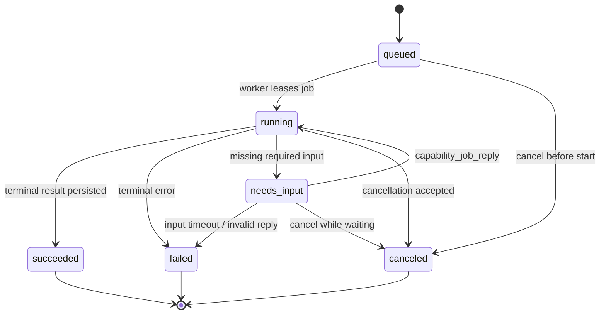

# Job 状态机与幂等语义（T0 冻结版）

## 1. 状态集合

```text
queued
running
needs_input
succeeded
failed
canceled
```

状态迁移：



## 2. 表与事件（T2 目标）

最小表：`jobs`、`job_events`（如需要）、`artifacts`。

`jobs` 至少包含：

- `id`
- `owner_user_id`
- `session_id`
- `capability`
- `input_hash`
- `idempotency_key`
- `status`
- `stage`
- `progress_percent`
- `result_json`
- `error_json`
- `needs_input_json`
- `created_at`、`updated_at`、`started_at`、`finished_at`、`expires_at`

唯一约束：

```text
UNIQUE(owner_user_id, idempotency_key)
```

没有幂等键的系统生成任务不允许外部重复提交去重，但仍必须有 job ID 和 owner。

## 3. 幂等规则

1. 第一次 `capability_run_submit`：创建 `queued` job。
2. 同 owner + 同 `idempotency_key` 重试：返回原 job，不重新执行、不重复扣费、不重复计分。
3. 已终态任务重复提交：返回终态 job 与原 artifacts。
4. 幂等键不同但 `capability/input` 相同：视为新任务，除非服务端另有安全去重策略。
5. 写工具（如 review submit）使用业务 `request_id` 去重，不能只依赖客户端重试时间。

## 4. Cancel 语义

| 当前状态 | cancel 行为 |
| --- | --- |
| `queued` | 可直接转 `canceled`，释放排队资源 |
| `running` | 置 cancel requested，底层 LLM/子进程/渲染任务应尽快停止；终态为 `canceled` |
| `needs_input` | 可转 `canceled` |
| `succeeded/failed/canceled` | 幂等返回，不改变状态 |

取消必须传播到：LLM 请求、子进程、Manim/Remotion 渲染、外部搜索和对象存储上传。已产生的 artifact 可保留或按策略清理，但不能假装不存在。

## 5. needs_input 语义

`needs_input` 只用于任务继续所必需的信息，例如：

- 题目缺少选项或题干；
- 视频渲染需要确认分辨率/风格；
- 精读需要指定章节；
- 材料引用无法解析。

普通聊天不使用 job reply。MCP 工具返回：

```json
{
  "status": "needs_input",
  "needs_input": {
    "fields": ["chapter"],
    "prompt": "要精读哪一章？"
  }
}
```

宿主 Skill 负责向用户追问，然后调用 `capability_job_reply`。

默认超时建议：24 小时；超时后进入 `failed`，错误码 `JOB_INPUT_TIMEOUT`。

## 6. failed 与重试

错误分两类：

- `retryable=true`：限流、网络、上游 5xx、临时对象存储失败；
- `retryable=false`：参数错误、权限不足、额度不足、能力缺失、内容安全拒绝。

是否创建新 job 由客户端/用户决定；重复使用原 `idempotency_key` 不会重试已失败任务，只会返回原失败记录。需要重试时生成新 key。

## 7. Artifact 关系

- 一个 job 可产生 0..N 个 artifact；
- artifact 二进制放 S3/MinIO，元数据放 Postgres；
- artifact 必须属于同一 owner；
- job 失败时可保留部分诊断 artifact，但默认不展示给普通用户；
- `artifact_get` 返回短期签名 URL，不返回本地路径。

## 8. 事件与可见性

建议事件类型：

```text
job.created
job.started
job.progress
job.needs_input
job.replied
job.succeeded
job.failed
job.cancel_requested
job.canceled
artifact.created
usage.recorded
```

`capability_job_get(include_events=true)` 可返回裁剪后的事件；外部宿主不得看到内部堆栈、服务器路径或 provider 密钥。
