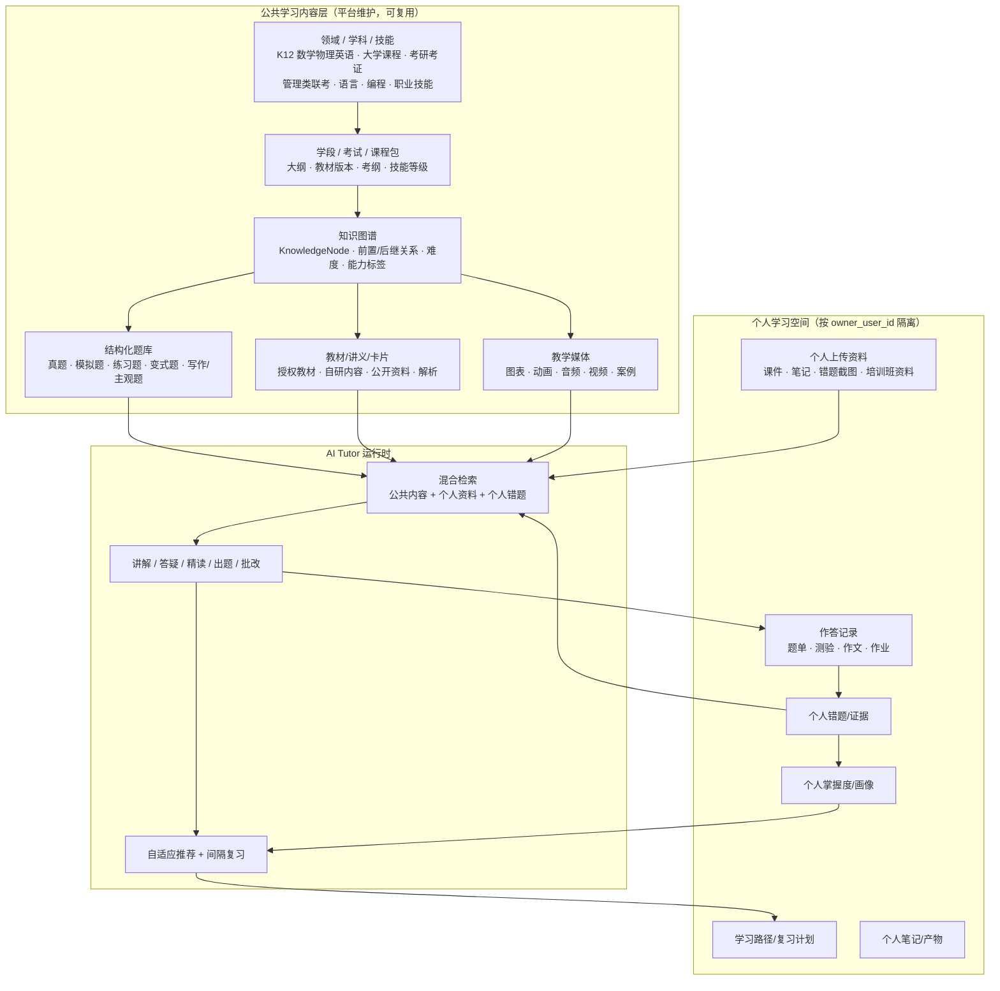

# DeepTutor 网站学习平台：共享学习内容与多学习包架构

> 版本：2026-11-01  
> 定位：这是 DeepTutor 自有网站/App 学习平台的产品与数据架构思路，不属于 WorkBuddy 集成方案。  
> 核心结论：DeepTutor 不应只提供空的 AI Agent 或要求每个用户自行找资料，而应建设平台统一维护的公共学习内容层（知识图谱、教材/讲义、结构化题库、解析、卡片和教学媒体），再以“学习包”的形式服务 K12、大学、考研考证、语言、编程和职业技能等不同人群。

## 1. 背景与定位

管理类联考只是一个示例，不应把平台限定为某个考试产品。更合理的底座是：

> **平台统一建设公共学习内容、RAG、题库和知识图谱；学习者按学段、学科、考试或技能选择学习包；个人资料、作答、错题、掌握度和学习计划按账户隔离。**

这使 DeepTutor 从“用户自带资料的 AI 工具”升级为“带内容资产、题库和长期学习效果的 AI 学习平台”。

## 2. 产品形态分层

- **公共内容层**：平台统一生产/采购/审核的学科知识、教材讲义、题库、解析、知识卡片和音视频内容，所有订阅相应学习包的用户共享。
- **个人学习层**：用户上传的资料、个人笔记、作答记录、错题、掌握度、学习计划和生成产物，全部按 `owner_user_id` 隔离。
- **AI Tutor 运行时**：基于公共内容、个人资料、历史错题和掌握度证据，完成讲解、答疑、精读、出题、批改、推荐和间隔复习。

## 3. 内容架构

### 3.1 三层内容模型



### 3.2 平台公共内容应覆盖的资产

| 资产 | 说明 | 典型例子 |
| ---- | ---- | -------- |
| 领域/学科 | 顶层学习领域 | 数学、英语、物理、计算机、经济学、医学、职业技能 |
| 学习包 | 可售卖/可订阅的内容单元 | K12 七年级数学、考研英语二、管理类联考、Python 入门、CPA 会计 |
| 知识图谱 | 知识点节点和先修关系 | “一元二次方程 → 二次函数”、“假言命题 → 形式逻辑” |
| 教材/讲义 | 授权或自研学习材料 | 章节讲义、公式规则、知识卡片、案例 |
| 结构化题库 | 题目、选项、答案、解析、标签 | 真题、模拟题、章节练习、变式题、主观题 |
| 试卷/练习集 | 可按组卷规则生成 | 套卷、章节测验、难度混合题单、每日练习 |
| 解析与错因 | 比题目本身更关键 | 正确思路、干扰项分析、常见坑、同类题 |
| 教学媒体 | 多模态解释 | Mermaid/SVG、Manim 动画、Remotion 视频、TTS 音频 |
| 评测规则 | 判分与反馈规则 | 客观题答案、主观题 rubric、写作评分维度 |

关键是：**公共内容不是一堆 PDF，而是带 ID、版本、标签、知识节点和适用学习包的结构化资产**。否则既无法做掌握度，也无法稳定推荐和出题。

### 3.3 学习包如何复用底座

```text
Learning Pack（学习包）
├── 适用对象：学段 / 专业 / 考试 / 技能等级
├── 知识图谱视图：选用哪些 KnowledgeNode
├── 教材与讲义：章节、卡片、媒体
├── 题库范围：题型、年份、难度、来源
├── 学习路径：基础 → 强化 → 真题/项目 → 冲刺
├── 诊断规则：入学测评和能力分层
├── 推荐策略：下一步学什么、练什么、复习什么
└── 商业化：免费 / 会员 / 专项包 / 训练营
```

同一个底座可以派生：

- K12：人教版/北师大版数学、初中物理、高中英语；
- 大学：高等数学、线性代数、概率论、数据结构、经济学原理；
- 考研考证：英语、政治、管综、法硕、教资、CPA；
- 技能：Python、Excel、数据分析、产品经理、语言学习；
- 企业/机构：新人培训、产品知识、合规考试（未来 B 端复用）。

### 3.4 数据权限边界

| 数据类型 | 共享范围 | 写入/更新 | 隔离要求 |
| -------- | -------- | --------- | -------- |
| 公共知识图谱/教材/题库/解析 | 所有订阅相应学习包的用户共享 | 平台内容运营/审核流程 | 公共内容版本化，用户不能直接改写 |
| 公共题目的作答统计 | 平台内部聚合 | 系统从匿名/授权作答聚合 | 不暴露个人答案和隐私 |
| 个人上传资料 | 用户本人 | 用户上传/删除 | `owner_user_id` 强隔离 |
| 个人作答、错题、掌握度、计划 | 用户本人 | AI Tutor 和学习事件写入 | 必须按账户行级隔离 |
| 教师/家长/机构视图 | 被授权者 | 未来 B 端能力 | 需要显式授权和最小可见范围 |

### 3.5 技术与运营含义

- **RAG 要升级为 Learning RAG**：检索对象不只是文档，还包括知识节点、题目、解析、卡片、个人错题和掌握度证据。
- **题库与文档索引分离**：题目需要结构化字段和精确查询，不能只靠向量相似度。
- **内容要版本化**：教材、题库、解析、rubric 更新后，旧学习记录仍能追溯当时版本。
- **先窄后宽**：底座按多学习包设计，但 MVP 只选 1 个学习包打透（例如管理类联考或七年级数学），验证“诊断→学习→练习→错题→掌握度→复习”的闭环后再扩品类。
- **版权优先**：公共教材/真题/机构讲义必须自研、授权或使用允许商用的来源；用户上传材料仅对本人可见。


## 4. MVP 建议

底座按多学习包设计，但第一个运营版本不要大而全。建议选择一个边界清晰、内容可结构化、付费意愿强的学习包打透：

1. 建立该学习包的知识图谱和知识点 ID；
2. 准备一批自研或授权讲义、知识卡片和结构化题目；
3. 做入学诊断和个人学习路径；
4. 跑通 AI 讲解、同类题练习、客观/主观题批改、错题沉淀、掌握度更新与间隔复习；
5. 输出周报和下一步建议；
6. 验证留存、付费和内容生产效率后，再复制到下一个学科/考试/技能。

最小闭环：

```text
选择学习包
→ 入学诊断
→ 生成学习路径
→ 学习知识点
→ AI 讲解/精读
→ 做题与批改
→ 错题归因
→ 更新掌握度
→ 到期复习
→ 周期学习报告
```

## 5. 后续可扩展学习包

- K12：教材版本化的数学、物理、英语等学科；
- 大学：高等数学、线性代数、概率论、数据结构、经济学原理；
- 考研考证：英语、政治、管综、法硕、教资、CPA；
- 技能：Python、Excel、数据分析、产品经理、语言学习；
- B 端：企业新人培训、产品知识、合规考试（复用同一底座，但另加组织、席位和报表）。

## 6. 与 WorkBuddy/MCP 的关系

该共享学习内容平台是 DeepTutor 自有平台能力。外部宿主（WorkBuddy、千问办公、豆包等）未来可以通过 MCP 使用其中一部分能力，但内容平台本身不依赖 WorkBuddy，也不应放到 WorkBuddy 集成文档中定义。
