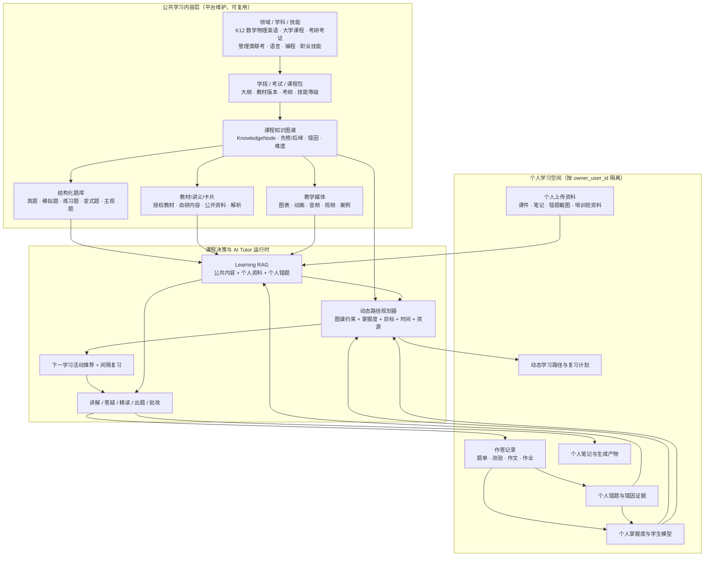

# DeepTutor 网站学习平台：共享学习内容与多学习包架构

> 版本：2026-11-03
> 定位：这是 DeepTutor 自有网站/App 学习平台的产品与数据架构思路，不属于 WorkBuddy 集成方案。
> 文档性质：产品与技术目标架构。文中“现有能力”和“目标能力”分别描述，不能把目标设计视为已经实现。
> 核心结论：DeepTutor 应从通用 AI 学习工具集合，进一步发展为**知识图谱约束、学习资源完备、持续跟踪学生状态的个性化伴学平台**。平台统一维护公共学习内容，以“学习包”服务不同人群；个人学习证据、掌握度和路径按账户隔离。

## 1. 背景与定位

管理类联考只是一个示例，底座不应被限定为某个考试产品。更合理的总体架构是：

> **平台统一建设公共学习内容、Learning RAG、题库和课程知识图谱；学习者按学段、学科、考试或技能选择学习包；个人资料、作答、错题、掌握度和学习计划按账户隔离。**

这使 DeepTutor 从“用户自带资料的 AI 工具”升级为“带内容资产、题库和长期学习状态的 AI 学习平台”。

在产品聚焦上，建议优先选择 **K12 图谱驱动的个性化伴学**：

- 中小学知识图谱提供课程骨架和先修约束；
- 练习题、解析、教学视频、教材和资料提供可执行的学习内容；
- DeepTutor 提供诊断、讲解、练习、批改、掌握度、动态路径和间隔复习；
- 第一方网站/App 承担完整伴学体验，WorkBuddy 等外部宿主作为渠道入口。

核心差异化不是“能生成多少课程内容”，而是：

> **知道此刻应该给这个学生哪一份内容，以及学生完成后下一步应该做什么。**

## 2. 产品形态分层

- **公共内容层**：平台统一生产、采购或审核的学科知识、教材讲义、题库、解析、知识卡片和音视频内容，所有订阅相应学习包的用户共享。
- **课程决策层**：课程知识图谱、诊断规则、掌握度策略、资源推荐策略和动态路径规划器，决定“学什么、先学什么、下一步做什么”。
- **个人学习层**：用户上传的资料、个人笔记、作答记录、错题、掌握度、学习计划和生成产物，全部按 `owner_user_id` 隔离。
- **AI Tutor 运行时**：基于公共内容、个人资料、历史错题和掌握度证据，完成讲解、答疑、精读、出题、批改、推荐和间隔复习。

第一方产品不应只呈现一个空白聊天框，还应提供“今日学习”“我的路径”“知识地图”“错题与复习”和“学习报告”等持续学习界面。

## 3. 内容架构

### 3.1 内容与学习闭环模型



### 3.2 平台公共内容应覆盖的资产

| 资产 | 说明 | 典型例子 |
| ---- | ---- | -------- |
| 领域/学科 | 顶层学习领域 | 数学、英语、物理、计算机、经济学、医学、职业技能 |
| 学习包 | 可售卖/可订阅的内容单元 | K12 七年级数学、考研英语二、管理类联考、Python 入门、CPA 会计 |
| 课程知识图谱 | 知识点、先修关系、易混淆关系和错因 | “一元二次方程 → 二次函数”、“假言命题 → 形式逻辑” |
| 教材/讲义 | 授权或自研学习材料 | 章节讲义、公式规则、知识卡片、案例 |
| 结构化题库 | 题目、选项、答案、解析、标签 | 真题、模拟题、章节练习、变式题、主观题 |
| 试卷/练习集 | 可按组卷规则生成 | 套卷、章节测验、难度混合题单、每日练习 |
| 解析与错因 | 比题目本身更关键 | 正确思路、干扰项分析、常见坑、同类题 |
| 教学媒体 | 多模态解释 | Mermaid/SVG、Manim 动画、Remotion 视频、TTS 音频 |
| 评测规则 | 判分与反馈规则 | 客观题答案、主观题 rubric、写作评分维度 |

关键是：**公共内容不是一堆 PDF，而是带 ID、版本、标签、知识节点和适用学习包的结构化资产**。否则既无法做掌握度，也无法稳定推荐和出题。

### 3.3 图谱、检索、学生模型与路径规划的职责

| 模块 | 回答的问题 | 主要资产 | 不应承担的职责 |
| ---- | ---------- | -------- | -------------- |
| 课程知识图谱 | 学什么？先学什么？ | 知识点、先修关系、章节、难度、错因 | 不直接证明学生已经掌握 |
| Learning RAG / 资源检索 | 根据什么内容讲解和练习？ | 教材、讲义、题目、解析、视频、个人资料 | 不单独决定完整学习路径 |
| 学生模型 | 学生现在会不会？证据是否充分？ | 作答、部分得分、错因、提示依赖、复习记录 | 不凭一次回答给学生贴永久标签 |
| 学习路径规划器 | 下一步最适合做什么？ | 图谱、掌握度、目标、可用时间和资源 | 不应由 LLM 无约束自由生成 |

**课程知识图谱不等于 GraphRAG。** GraphRAG 主要解决文档索引和检索；课程知识图谱是学习顺序、教学依赖和路径规划的约束骨架。两者应通过稳定的知识点 ID 关联，而不是混为同一个模块。

### 3.4 K12 知识图谱与资源接入规范

#### 知识点和关系

除知识点名称外，建议至少保留以下逻辑字段；这不是最终数据库 DDL：

```text
KnowledgePoint
├── id：稳定且跨资源复用的 knowledge_point_id
├── subject / grade / semester / textbook_version
├── name / description / chapter
├── difficulty / cognitive_level / estimated_minutes
├── common_misconceptions
└── graph_version

KnowledgeEdge
├── prerequisite：学习当前节点前需要掌握的先修节点
├── contains：章节、父子知识点或组成关系
├── related：一般关联，不能当作先修条件
└── confusable_with：易混淆知识点及差异说明
```

先修关系需要校验循环依赖、适用年级和版本。`related` 不能被路径规划器误用为强制前置条件。错因和易混淆关系对补救教学的价值通常高于单纯的知识分类。

#### 资源绑定

教材、题库、视频和资料不能只进入统一向量库，还要与知识点建立多对多绑定：

```text
ResourceBinding
├── resource_id / resource_version
├── knowledge_point_id
├── role：teach | diagnose | practice | remediate | enrich
├── difficulty / cognitive_level
├── grade / textbook_version / chapter
├── duration / answer / explanation / rubric（按资源类型选用）
├── quality_status / rights_status
└── content_version
```

示例：

- 教材第 3.2 节 → “二次函数顶点式” → `teach`；
- 某 6 分钟视频 → “二次函数顶点式” → `teach/remediate`；
- 题目 Q1024 → “顶点坐标” → `diagnose`；
- 题目 Q1025 → “顶点符号错误” → `remediate`；
- 拓展阅读 → “函数图像变换” → `enrich`。

题目需要结构化字段和精确查询，不能只依赖向量相似度。教材、视频和题目更新后，历史作答仍要能追溯当时使用的资源版本。

### 3.5 学习资源编排策略

资源使用遵循“**已有审核内容优先，AI 生成补缺口**”：

1. 优先使用已有且审核过的教材、视频、题目和解析；
2. 对已有内容进行检索、截取、组合和重新排序；
3. AI 生成分步提示、个别化讲解、学习卡片和变式题；
4. 只有资源缺口明确时，才调用 `video_lesson`、`math_animator` 等能力补做媒体；
5. 生成内容进入公共学习包前需要审核，不能直接把单次模型输出当作平台标准课程内容。

### 3.6 学习包如何复用底座

```text
Learning Pack（学习包）
├── 适用对象：学段 / 专业 / 考试 / 技能等级
├── 知识图谱视图：选用哪些 KnowledgeNode 和版本
├── 教材与讲义：章节、卡片、媒体
├── 题库范围：题型、年份、难度、来源
├── 学习路径模板：基础 → 强化 → 真题/项目 → 冲刺
├── 诊断规则：入学测评和能力分层
├── 推荐策略：下一步学什么、练什么、复习什么
└── 商业化：免费 / 会员 / 专项包 / 训练营
```

同一个底座可以派生：

- K12：人教版/北师大版数学、初中物理、高中英语；
- 大学：高等数学、线性代数、概率论、数据结构、经济学原理；
- 考研考证：英语、政治、管综、法硕、教资、CPA；
- 技能：Python、Excel、数据分析、产品经理、语言学习；
- 企业/机构：新人培训、产品知识、合规考试（未来 B 端复用）。

底座按多学习包设计，不代表首个运营版本要同时覆盖所有品类。

### 3.7 数据权限边界

| 数据类型 | 共享范围 | 写入/更新 | 隔离要求 |
| -------- | -------- | --------- | -------- |
| 公共知识图谱/教材/题库/解析 | 所有订阅相应学习包的用户共享 | 平台内容运营/审核流程 | 公共内容版本化，用户不能直接改写 |
| 公共题目的作答统计 | 平台内部聚合 | 系统从匿名/授权作答聚合 | 不暴露个人答案和隐私 |
| 个人上传资料 | 用户本人 | 用户上传/删除 | `owner_user_id` 强隔离 |
| 个人作答、错题、掌握度、计划 | 用户本人 | AI Tutor 和学习事件写入 | 必须按账户行级隔离 |
| 教师/家长/机构视图 | 被授权者 | 教师/家长辅助管理 | 需要显式授权和最小可见范围 |

K12 场景还需遵守未成年人数据最小化、监护人或学校授权、内容版权和数据删除要求。产品文案不得承诺提分或官方考试结果。

### 3.8 技术落地原则

- **Learning RAG**：检索对象不只是文档，还包括知识节点、题目、解析、卡片、个人错题和掌握度证据。
- **题库与文档索引分离**：题目需要结构化字段、答案/rubric 和精确查询。
- **内容版本化**：图谱、教材、题库和解析更新后，旧学习记录仍可追溯。
- **图谱存储可替换**：MVP 可先用 PostgreSQL 与图谱适配层实现先修遍历；已有 Neo4j 等图谱可通过服务接口接入，不要求先迁移。
- **规则与模型分工**：图谱遍历、掌握度更新和路径硬约束使用可测试代码；LLM 负责解释、交互和非结构化内容理解。
- **先窄后宽**：先选一个学习包验证闭环，再复制到其他学科和考试。
- **版权优先**：公共教材、真题和机构讲义必须自研、授权或使用允许商用的来源；用户上传材料仅对本人可见。

## 4. 图谱约束的自定义路径与伴学闭环

### 4.1 动态路径不是一次性课表

真正的个性化路径应持续根据学习证据重规划：

```text
设定目标
→ 诊断目标知识点及必要先修知识
→ 生成初始路径
→ 推荐下一个学习活动
→ 学习 / 练习
→ 收集作答与学习行为证据
→ 更新掌握度和错因
→ 重新排序后续路径
→ 安排间隔复习
```

路径规划至少考虑：

- 目标知识点及其必要先修闭包；
- 每个知识点的掌握度和证据充分度；
- 当前可学习节点，而不是机械遵循教材页序；
- 学生目标、每天可用时间和路径期限；
- 可用于讲解、诊断、练习和补救的真实资源；
- 最近错误、提示依赖和间隔复习到期情况。

每个路径目标必须绑定真实的 `knowledge_point_id`、先修条件、资源 ID、达标规则和复习规则，不能只包含模型生成的阶段标题。

目标内部 API 可围绕以下语义设计；这不表示它们已经全部存在：

- `learning_path_create`：根据目标、图谱版本和诊断结果建立路径；
- `learning_path_next`：返回当前最合适的下一项学习活动；
- `learning_step_complete`：记录活动结果并触发掌握度和路径更新；
- `mastery_map_get`：读取知识点掌握度和证据；
- `resource_recommend`：为当前知识点选择教材、视频、题目或补救材料。

### 4.2 示例：二次函数顶点坐标

1. 诊断发现学生顶点公式不熟，同时“完全平方”也不稳定；
2. 规划器先补完全平方，而不是直接反复讲顶点公式；
3. 推荐一段已有教材和 6 分钟教学视频；
4. 安排 3 道梯度练习；
5. 如果学生因符号错误答错，推送针对符号错误的讲解和变式题；
6. 分别更新“完全平方”和“顶点坐标”的掌握度及错因证据；
7. 动态调整后续路径，并安排到期复习。

大模型负责解释和交互，图谱与学习规则负责约束路径，学生证据负责触发调整。

### 4.3 DeepTutor 现有能力与目标差距

| DeepTutor 现有能力 | 在伴学产品中的角色 | 目标改造重点 |
| ------------------ | ------------------ | ------------ |
| 原生 mastery 知识点、先修关系和路径存储 | 学习地图和路径基础 | 接入平台公共图谱及版本化资源绑定 |
| `compute_mastery` | 当前按近期作答计算掌握度，并限制少证据时的置信上限 | 保持策略可替换，数据充分后再评估 BKT/IRT 等模型 |
| MCP `mastery_path_generate` | 当前由 LLM 一次性生成 2–6 个目标并写入 PostgreSQL | 升级为图谱约束、可随学习证据重规划的动态路径 |
| `practice_*` 与 SRS | 练习、判分、错题、学习证据和复习 | 绑定知识点、错因、题目版本和路径活动 |
| `immersive_reading` | 教材、讲义和个人资料精读 | 保留原文引用，并回写学习活动结果 |
| `deep_solve` | 分步提示和答疑 | 优先 scaffolding，避免只给最终答案 |
| `deep_question` | 补题和变式题 | 受知识点、难度、rubric 和质量审核约束 |
| `video_lesson` / `math_animator` | 教学媒体生成 | 只补明确资源缺口，不替代已有内容库 |
| WorkBuddy / MCP | 外部宿主入口 | 只暴露所需学习能力，不搬移第一方学生模型 |

最优先的技术改造是：把一次性 LLM 路径生成升级为 **graph-constrained dynamic path planner**，同时保留现有可替换的掌握度策略、练习和 SRS 基础。

## 5. 产品方向与优先级

### 5.1 建议主线

**图谱驱动、资源完备、持续跟踪学生状态的 K12 AI 伴学。**

- 第一方网站/App 是主产品，承载长期路径、学习记录和学习报告；
- WorkBuddy 是渠道和外部入口，不承担核心学生模型；
- 腾讯 ima 是个人资料来源之一，不替代平台公共课程体系；
- AI 对话是交互方式，不是产品全部；
- 教师/家长视图用于展示学习证据、进步和薄弱点，并支持授权范围内的目标调整。

### 5.2 暂不优先投入

- 泛办公助手和与伴学无关的通用能力扩张；
- 全学段、全学科同时铺开；
- 没有掌握度和学习闭环的知识图谱可视化；
- 大规模自动生成公共课程；
- 在数据不足时过早引入复杂 BKT/IRT；
- 在 MVP 前引入无法被业务需求证明必要的重型图数据库基础设施。

### 5.3 效果指标

不能只用对话流畅度、生成数量或使用时长验收，应重点关注：

- 前测到后测的学习增益；
- 7 天、30 天后的保持率；
- 薄弱知识点和具体错因是否消除；
- 推荐资源的有效完成率；
- 学生是否逐渐减少提示依赖；
- 路径是否因作答证据发生合理变化；
- 讲解和出题的引用、答案及 rubric 合格率；
- 后续再验证留存、付费和公共内容生产效率。

## 6. K12 MVP 建议

底座按多学习包设计，但第一个运营版本不要大而全。建议选择边界清晰、资源已具备的单元，例如“初中数学·二次函数”。以下数量是建议规模，不是硬性门槛：

1. 导入约 20–50 个知识点及其先修、易混淆和错因关系；
2. 绑定一批审核过的结构化题目、解析、教材章节和现有视频；
3. 建立入学诊断，覆盖目标知识点及必要先修知识；
4. 实现动态 `learning_path_next`，每次推荐当前最合适的下一项活动；
5. 跑通教材/视频学习、AI 讲解、练习批改、错因沉淀、掌握度更新和 SRS；
6. 证明作答结果会改变后续路径，而不是只更新展示分数；
7. 输出学生周报以及教师/家长可读的学习证据；
8. 验证学习效果、留存、付费和内容生产效率后，再复制到下一章节或学科。

最小闭环：

```text
选择学习包
→ 入学诊断
→ 生成图谱约束的初始路径
→ 学习知识点
→ AI 讲解 / 教材精读 / 已有视频
→ 做题与批改
→ 错题归因
→ 更新掌握度
→ 动态调整路径
→ 到期复习
→ 周期学习报告
```

MVP 验收还应覆盖：

- 路径不会违反先修关系，也不会因一次猜对就跳过必要学习；
- 无合适资源时能明确报告缺口，不伪造教材、视频或题目；
- 公共内容、个人资料和不同学生的数据权限隔离；
- 资源、图谱、作答和掌握度变化可以追溯版本与证据；
- 生成媒体不是完成学习活动的必要条件，已有资源可独立支撑闭环。

## 7. 后续可扩展学习包

- K12：教材版本化的数学、物理、英语等学科；
- 大学：高等数学、线性代数、概率论、数据结构、经济学原理；
- 考研考证：英语、政治、管综、法硕、教资、CPA；
- 技能：Python、Excel、数据分析、产品经理、语言学习；
- B 端：企业新人培训、产品知识、合规考试（复用同一底座，但另加组织、席位和报表）。

## 8. 与 WorkBuddy/MCP 的关系

该共享学习内容平台是 DeepTutor 自有平台能力。第一方 App/Web/SDK 直接调用内部应用服务，不应绕过 MCP。

外部宿主（WorkBuddy、千问办公、豆包等）未来可以通过 MCP 使用其中一部分能力，例如知识库检索、路径查询、下一学习活动、练习提交和掌握度读取，但必须遵守：

- 外部宿主不能绕过 `owner_user_id` 访问其他学生的图谱状态、作答和资料；
- 公共图谱与资源只读暴露，内容运营和审核仍由 DeepTutor 平台负责；
- 宿主负责意图理解、交互和结果呈现，不伪造检索、掌握度或学习活动结果；
- 内容平台本身不依赖 WorkBuddy，也不应放到 WorkBuddy 集成文档中定义；
- 腾讯 ima 等外部资料库是资源连接器，不等于 DeepTutor 的公共课程知识图谱。

## 9. 开发实施路线与代码落点

### 9.1 第一条开发主线

不要同时改图谱、数据库、Agent、前端和 MCP。第一条垂直开发主线应是：

```text
初中数学一个小单元
→ 导入知识图谱
→ 诊断
→ 推荐下一学习活动
→ 作答
→ 更新掌握度
→ 路径发生变化
```

建议按 5 个可独立验收的 PR 推进：

```text
PR 1：图谱模型 + 资源选择 + 纯规划器 + 二次函数 fixture + 测试
PR 2：PostgreSQL 公共图谱/资源表 + 导入器 + 映射字段
PR 3：个人路径创建 + 下一活动 + assessment 回写 + 动态重规划
PR 4：复用 Mastery 前端完成一个可用伴学页面
PR 5：WorkBuddy/MCP 暴露部分能力
```

### 9.2 必须复用的现有代码

| 现有代码 | 已有职责 | 开发时的处理 |
| -------- | -------- | ------------ |
| `deeptutor/learning/models.py` | `KnowledgePoint`、`LearningProgress`、`LearningEvidence`、作答和复习状态 | 保留为学生个人学习状态模型 |
| `deeptutor/learning/policy.py` | 掌握度门禁、`next_objective()`、到期复习和下一目标 | 继续作为个人路径决策基础，不另写掌握度分数 |
| `deeptutor/learning/objective_relations.py` | 先修关系、引用校验、循环依赖检测 | 与公共图谱 DAG 校验对齐，必要时提取共享函数 |
| `deeptutor/learning/assessment.py` | 其他学习场景通过 `record_assessment()` 写入掌握证据 | 练习、精读等活动完成后从这里进入学习闭环 |
| `deeptutor/learning/storage_postgres.py` | PostgreSQL 个人路径、事件和交互存储 | 继续保存个人路径，不把学生状态写进公共图谱 |
| `deeptutor/services/mastery/path_generator.py` | 当前 MCP 一次性 LLM 路径生成 | 增加图谱规划分支，保留通用旧路径兼容 |
| `deeptutor/api/routers/mastery_path.py` | 第一方学习路径 API | 增加学习包和下一学习活动入口 |

需要始终保持以下边界：

- 公共图谱节点和学生个人知识点状态不是同一种数据；
- 公共资源由平台共享和审核；
- 掌握度、作答、路径和复习记录属于学生个人；
- 新 SaaS/MCP 路径使用 PostgreSQL，不能打开现有业务 SQLite。

### 9.3 PR 1：纯 Python 图谱与规划器

第一个 PR 不接数据库、不改前端、不调用 LLM，先用测试证明学习决策正确，并且不改变现有运行时行为。

#### 新增领域代码

```text
deeptutor/learning/curriculum/
├── __init__.py
├── models.py
├── graph.py
├── resources.py
└── planner.py
```

`models.py` 定义公共课程模型：

- `CurriculumGraph`；
- `CurriculumNode`；
- `CurriculumEdge`；
- `LearningResource`；
- `ResourceBinding`；
- `LearningActivity`；
- `LearnerSnapshot`。

不要直接拿现有 `KnowledgePoint` 充当公共图谱节点。现有模型包含个人路径的 `module_id`、视觉任务等语义，公共图谱独立建模，再通过 ID 映射。

`graph.py` 实现无 I/O 的图谱操作：

- 图谱导入校验；
- 未知节点、重复 ID 和循环依赖检测；
- 目标知识点的先修闭包；
- 根据已掌握节点计算可学习节点；
- 区分 `prerequisite`、`related` 和 `confusable_with`，不能把所有边都当成先修关系。

`resources.py` 实现确定性的资源选择：

- 当前动作是 `diagnose` 时优先诊断题；
- 初次学习优先教材或教学视频；
- 特定错因优先 `remediate` 资源；
- 已掌握但到期时优先复习题；
- 没有资源时返回 `resource_gap`，不允许虚构资源。

`planner.py` 组合公共图谱、学生掌握度、学习目标、可用资源和每日时间，输出统一的 `LearningActivity`：

```text
action: diagnose | teach | practice | remediate | review
knowledge_point_id
resource_id
reason
estimated_minutes
resource_gap
```

掌握度判断调用现有 `deeptutor/learning/policy.py`，规划器中不重新发明一套分数。

#### 新增测试与样例

```text
deeptutor/learning/tests/
├── fixtures/k12_quadratic.json
├── test_curriculum_graph.py
├── test_curriculum_resources.py
└── test_curriculum_planner.py
```

至少覆盖：

1. 循环先修关系无法导入；
2. 学生学习二次函数但完全平方未掌握时，先推荐完全平方；
3. 已掌握的先修知识可以跳过；
4. 一次答对不能直接视为充分掌握；
5. 符号错误能命中对应补救资源；
6. 没有视频时可以返回教材，不强行生成视频；
7. 什么资源都没有时返回 `resource_gap`；
8. 学生答错后，下一次规划结果发生变化。

第一阶段测试命令：

```bash
python -m pytest \
  deeptutor/learning/tests/test_curriculum_graph.py \
  deeptutor/learning/tests/test_curriculum_resources.py \
  deeptutor/learning/tests/test_curriculum_planner.py -q
```

### 9.4 PR 2：PostgreSQL 与资源导入

#### 新增 migration

当前迁移到 `0004`，下一步新增：

```text
alembic/versions/0005_curriculum_graph_resources.py
```

第一版建议只建公共内容表：

- `curriculum_graphs`；
- `curriculum_nodes`；
- `curriculum_edges`；
- `learning_resources`；
- `learning_resource_nodes`。

第一版不必立刻新增 `learning_activities` 表。个人作答、掌握度和事件先复用现有 `LearningProgress`、Postgres 路径状态和 assessment 机制，避免重复记账。

公共图谱表不简单添加 `owner_user_id`，因为它们属于平台公共内容。个人学习记录继续按 `owner_user_id` 隔离，涉及个人表时沿用现有 RLS 方式。

#### 新增服务层

```text
deeptutor/services/curriculum/
├── __init__.py
├── importer.py
├── postgres.py
└── service.py
```

分别负责：

- JSON/CSV 图谱和资源导入；
- PostgreSQL 读写；
- 学习包、图谱版本和资源查询；
- 导入失败时使用事务回滚，不留下半张图谱。

#### 少量修改个人模型

在 `deeptutor/learning/models.py` 中增加向后兼容的可选映射字段：

- `LearningProgress.learning_pack_id`；
- `LearningProgress.graph_version`；
- `LearningProgress.path_mode`；
- `KnowledgePoint.curriculum_node_id`。

默认值保持旧路径可用，旧 JSON 不需要强制迁移。资源列表、掌握度等个人数据不能塞进公共图谱节点。

### 9.5 PR 3：接入现有学习运行时

#### 图谱路径应用服务

新增：

```text
deeptutor/services/mastery/graph_guided.py
```

负责：

- 从公共图谱生成个人路径；
- 把公共节点映射为个人 `KnowledgePoint`；
- 调用规划器得到下一活动；
- 活动完成后调用现有 assessment；
- 重新读取掌握度并重规划。

不要把大量新逻辑继续塞进已经很长的 `deeptutor/learning/service.py` 或 `deeptutor/capabilities/mastery/tools.py`。

#### 修改 MCP 路径生成器

修改 `deeptutor/services/mastery/path_generator.py`：

- 请求带 `learning_pack_id` 时走图谱规划；
- 普通“帮我学习某个主题”保留现有 LLM 通用路径；
- 图谱缺失或资源不全时明确返回缺口，不悄悄退回自由生成并冒充图谱路径。

#### 修改第一方 API

修改 `deeptutor/api/routers/mastery_path.py`，逐步增加：

- 创建路径时接受 `learning_pack_id`；
- 获取当前 `next_activity`；
- 完成活动并提交结果；
- 返回推荐原因和资源缺口。

如果新增独立课程管理路由，可以创建：

```text
deeptutor/api/routers/curriculum.py
```

同时更新 `deeptutor/modules/manifests/mastery.json`，注册新服务路径和路由。图谱导入接口必须使用管理权限，不能让普通学生修改公共图谱。

#### 让练习真正改变路径

练习判分不能只停留在 `practice` 的“回答正确”返回值，应通过现有 `deeptutor/learning/assessment.py` 写入 `mastery_path_id + knowledge_point_id` 关联证据。

可以给 `LearningEvidence` 增加可选字段：

- `activity_id`；
- `resource_id`；
- `resource_version`；
- `misconception_id`。

随后由图谱路径服务重新计算下一活动。

### 9.6 PR 4：接入第一方前端

优先复用现有 Mastery 页面，不先另做独立平台。

主要修改：

- `web/lib/learning-api.ts`：增加学习包、图谱路径和下一活动 API 类型；
- `web/components/space/learning/CreateTopicWizard.tsx`：支持从学习包创建路径；
- `web/components/space/learning/MasteryStudy.tsx`：展示当前学习活动；
- `web/components/space/learning/LearningBoard.tsx`：展示掌握状态与路径变化；
- `web/components/space/learning/StudyOutline.tsx`：区分公共图谱节点、已掌握、待补先修和待复习。

第一版 UI 只需做好一个页面：

```text
今日目标
→ 当前为什么推荐这个知识点
→ 教材 / 视频 / 练习
→ 提交结果
→ 掌握度变化
→ 下一步推荐
```

推荐理由必须可理解，例如：“因为顶点坐标依赖完全平方，而你最近两次完全平方练习均未通过。”

### 9.7 PR 5：最后开放 MCP

第一方闭环稳定后，再修改 `deeptutor/mcp_server/server.py`，按需增加：

- `learning_packs_list`；
- `learning_path_create`；
- `learning_path_next`；
- `learning_activity_complete`；
- `knowledge_search`。

不要从 MCP 开始开发。第一方 App/Web 直接调用内部服务；MCP 只是 WorkBuddy 等外部宿主的适配层。

### 9.8 回归验证

每个 PR 运行对应的新测试，并在涉及现有学习逻辑时补充回归：

```bash
python -m pytest deeptutor/learning/tests -q
```

涉及 MCP 适配时运行：

```bash
python -m pytest tests/mcp_server -q
```

涉及 Skill 包或工具契约变化时运行：

```bash
python -m pytest tests/workbuddy_skills -q
```

前端按现有 `web/package.json` 脚本执行类型检查和相关 Mastery/learning 测试，并新增图谱路径的 UI 测试。每个 PR 都必须能独立验收，不等整个平台完成后才验证图谱数据或学习闭环。
